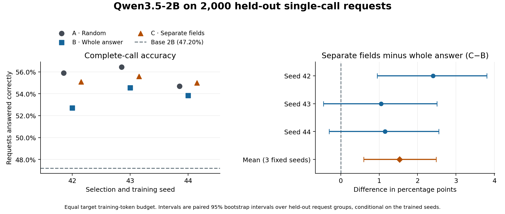

# S2L for Tool Calling

Can a small language model select better fine-tuning examples by tracking which function to call and which arguments to supply? This repository contains the data preparation, training, exact-match evaluator and results for a controlled experiment with Qwen3.5 and Amazon Turnstile.

## Try it on your laptop

You need Git and Python 3.10 or newer. The following commands run offline after cloning and use only the Python standard library.

```bash
git clone https://github.com/yjing86/s2l-tool-calling.git
cd s2l-tool-calling
python3 -m s2l_tool_calling demo
python3 -m s2l_tool_calling score --input examples/calls.jsonl
python3 -m s2l_tool_calling results
```

1. **See how grading works.** The demo marks the function name and argument value in an order-tracking call and compares two hand-written sets of answers. Model X gets 2/4 correct and model Y gets 3/4.
2. **Score your own predictions.** The five example records cover an exact match, a wrong function, wrong arguments, a wrong number of calls and a parsing error. The sample scores 1/5. Replace the records with your model's decoded single-call responses and add `--output verdicts.jsonl` to save a verdict per request. [Input format and worked example](examples/README.md)
3. **Inspect the measured result.** The last command reads the checked-in study aggregate. It prints each seed's accuracy and paired contrasts. Use `results --input PATH` to inspect the summary from your own reproduction. [Turnstile aggregate](results/turnstile-single-call.json) · [BFCL aggregate](results/bfcl-single-turn.json)

**Select examples from your own training pool.** If you already have per-example losses at five proxy checkpoints, you can run the selector on CPU. From a Python 3.12 virtual environment:

```bash
python -m pip install -r requirements/selection.txt
python -m s2l_tool_calling select --input examples/trajectories.jsonl --count 4 --clusters 3
```

Replace the synthetic trajectories with your own to get selected training IDs. The GPU guide covers extracting trajectories from a model. [Trajectory schema and sampling options](examples/README.md)

## Reproduce the GPU study

Start with the [GPU reproduction guide](docs/reproduce.md). It covers the hardware, pinned downloads, environment setup, split checks, cost-sensitive design choices, training, evaluation, and the files that signal completion. The measured run used one NVIDIA A40. Training uses ms-swift, generation uses vLLM, and external scoring uses the official BFCL checker. The three environments have separate dependency lists. The root requirements file is for the local Hugging Face field-loss check. [Installation and package versions](docs/environment.md) · [Workstation requirements](requirements.txt) · [GPU requirements](requirements/)

After preparing your inputs, you can verify all six split and audit files against the published fingerprints and check that your GPU budget produced the same study design. From the checkout root:

```bash
python3 -m s2l_tool_calling verify --prepared local/prepared --design local/course-run/design.json
```

To redraw the main figure from the published aggregate, install Matplotlib in your plotting environment and run:

```bash
python3 -m s2l_tool_calling plot --input results/turnstile-single-call.json --output outputs/heldout-results.png
```

## What the experiment found

One Qwen3.5-0.8B proxy trained on 4,000 single-call requests. At steps 0, 10, 30, 80 and 250, we recorded the loss on each reference answer. Each method selected 1,000 requests. The Qwen3.5-2B targets trained on complete reference calls under a common budget of 3,005,228 non-padding input tokens, with rounding at the final optimizer step.

| Selection method | Mean complete-call accuracy on Turnstile |
| --- | ---: |
| Untuned 2B, evaluated once | 47.20% |
| A · Uniform random sampling | 55.68% |
| B · Cluster trajectories of whole-answer loss | 53.70% |
| C · Cluster separate trajectories for function names and argument values | 55.23% |

C beat B in all three paired seeds on 2,000 held-out requests. The mean gain was **1.53 percentage points** (95% paired interval +0.60 to +2.48). C scored **0.45 points below random** on average (−1.42 to +0.53). Across three seeds, pooling the function-name and argument-value tokens into a single trajectory (B′) gained 1.07 points over B. The additional gain from giving the two fields separate trajectories (C−B′) was 0.47 points, with a paired 95% interval of −0.40 to +1.32. On two exploratory BFCL categories with 100 questions each, C−B was −1.33 points (−3.00 to +0.33). These intervals quantify test-question uncertainty conditional on the trained models. [Full results and limitations](docs/results.md)

We then trained 11 additional models on the same token budget. Random sampling with B’s argument-length quotas averaged **54.43%**, length-adjusted whole-answer trajectories **54.23%**, and proportional sampling by tool name **54.77%**. Uniform random sampling remained highest among the seven 1,000-request strategies tested at all three seeds. These follow-ups used the already opened Turnstile test. [All 21 trained endpoints and paired comparisons](docs/results.md#three-seed-controls-for-fields-length-and-tool-coverage) · [Machine-readable results](results/followup/phase1-results.json)

A further three-seed control matched random sampling’s argument-length bins and B’s initial argument-difficulty bins. It reached **55.37%**, compared with **55.68%** for unrestricted random sampling (difference −0.32 pp, paired 95% interval −1.20 to +0.58). Matching difficulty alone at these lengths did not reproduce B’s shortfall. [Difficulty-control results](results/followup/e2b-results.json) · [Ten-minute research talk](docs/project-story.md)



## Find the code and supporting material

| If you want to… | Open |
| --- | --- |
| Use the scorer with another model's outputs | [Examples and input schema](examples/) |
| Change the downloader, analysis or user-facing commands | [Python package](s2l_tool_calling/) |
| Find the split, proxy, clustering, training, scoring or experiment controller | [Program index by stage](scripts/README.md) |
| Compare a rerun with the published results and configuration | [Aggregates and reproduction target](results/) |
| Understand the hypotheses, controls and interpretation | [Research plan](docs/research-plan.md) |
| Investigate length, tool coverage and the pooled-field control | [Post-hoc analyses and registered follow-up](docs/improvement-plan.md) |
| Check the token masks and reproduce the numerical field losses | [Field-loss validation](docs/field-loss-validation.md) |
| Inspect the experimental record or study the related work | [Experiment log](docs/experiment-log.md) · [Paper notes](docs/references.md) |

The downloader fetches the training corpus and model weights from their upstream revisions. Amazon distributes Turnstile under CC BY-NC 4.0. Raw prompts, weights, adapters and per-request predictions are kept in the ignored `local/` tree. [Turnstile snapshot](https://huggingface.co/datasets/amazon/Turnstile-Synthetic-Domains/tree/70bf9e9a6234e694efa36d1ec6c207c65a695f5b) · [Proxy weights](https://huggingface.co/Qwen/Qwen3.5-0.8B/tree/2fc06364715b967f1860aea9cf38778875588b17) · [Target weights](https://huggingface.co/Qwen/Qwen3.5-2B/tree/15852e8c16360a2fea060d615a32b45270f8a8fc)
