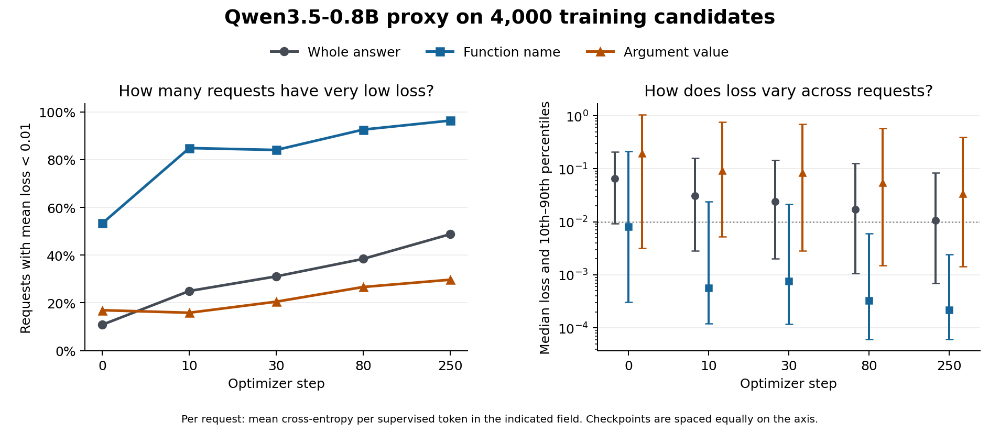
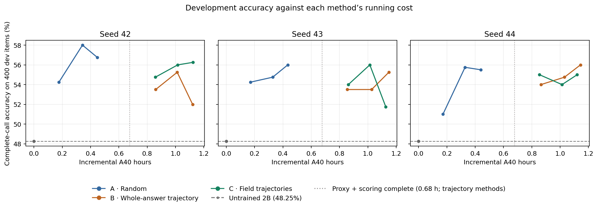

# A40 experiment log

This log records what ran and where to verify it. The [research plan](research-plan.md) defines the hypotheses, comparisons and stopping rules. All server times use UTC. Los Angeles was on PST (UTC−8) in November 2026, so November 24 at 00:51 UTC was November 23 at 16:51 in Los Angeles.

## Data and software

| Component | Observed configuration | Evidence |
|---|---|---|
| Single GPU | NVIDIA A40, 46,068 MiB, driver 595.112.07, Python 3.12.3. The driver reported support for CUDA 13.2. The training environment used PyTorch 2.8.0+cu128. | `/workspace/cs260d/logs/preflight.txt` on the persistent GPU volume, `gpu.csv` sampled every 30 seconds, and each training run's `run.json` |
| Model snapshots | Qwen3.5-0.8B `2fc06364715b967f1860aea9cf38778875588b17` and Qwen3.5-2B `15852e8c16360a2fea060d615a32b45270f8a8fc`. Both snapshots were verified on the pod. | `logs/download.txt` |
| Dataset snapshot | Turnstile `70bf9e9a6234e694efa36d1ec6c207c65a695f5b`. Split seed 31415. The combined input/output limit was 4,096 tokens, with at most 512 output tokens. | `local/prepared/manifest.json` and `rows.audit.jsonl` |
| Experiment code | Initial plan `b923536`, trainer `5939492`, data and inference code `6598260`, scoring/selection/BFCL utilities `fae15e0`. | Each run directory contains its actual arguments, file hashes and software versions. |

### Frozen evaluation manifests

Of 8,728 single-call Turnstile candidates, 29 had argument keys outside their schemas, 14 exceeded the output window and 2 failed type validation. Four additional eligible examples duplicated others in their group. We isolated debugging examples from all formal splits. The resulting splits contained 3 debug examples, 200 pilot requests, 4,000 candidate training requests, 400 development requests and 2,000 held-out test requests. Remaining eligible groups were unused. The training, pilot and test files produced identical SHA-256 hashes on the local machine and the GPU server.

| Split | SHA-256 |
|---|---|
| Training pool | `fd0ee69020ff537165b0fc405883f33ea2269ccc14cd4a231f62e5aff32e6001` |
| Pilot | `525aebaa6ef83dce9152eabbb89ebe99b5614947eddd78358333606dd8da6476` |
| Held-out test | `000c29f46a06a35146d8d369e4ff763226bf66a690a7339680e32fc8b779407c` |

For the external BFCL evaluation, we fixed 100 requests each from `simple_python` and `multiple`. The generation input contained only the requests and tools. Its SHA-256 was `626b8855e169b2c0aefef13517946ab50100e277f48d55ac461569c78ca695ad`. Comparing these requests with the training pool yielded zero matches under the specified prompt, tool-name and named-signature checks. The official AST scorer passed six hand-written functional test cases per category. Replacing all 200 predictions with unparseable outputs left both denominators at 100. The manifests and scorer tests are in `local/bfcl/manifest.json` and `local/bfcl/validation.json`.

## Timeline

| UTC on 2026-11-24 | Operation and outcome |
|---|---|
| 00:51 | Recorded the GPU, driver, disk, Python and initial package versions. The checkout was at `/workspace/cs260d/repo`, with run artifacts under `local/runs`. Installation logs, job output and GPU telemetry were stored in `/workspace/cs260d/logs`. |
| 00:54–00:56 | A 0.8B one-step training check overlapped with package installation and failed to import `torch.torch_version`. The first log is `logs/smoke1.log`. After installation, we reran it in `local/runs/proxy-smoke2`. One step on row 49 produced loss 0.1016, gradient norm 4.352 and an active step time of about 4.45 seconds. ms-swift wrote `checkpoint-1`. |
| 00:56 | Reloaded the same 0.8B adapter and scored row 49 with the actual ms-swift template. Of 1,438 input tokens, 79 received supervision. The manually computed whole-answer loss was 0.0222907234 and the model's reported loss was 0.0222907215, an absolute difference of about 1.9×10⁻⁹. The six function-name tokens averaged 0.006271, the 12 argument-value tokens 0.074211 and the other 61 tokens 0.013653. See `logs/gpu-probe.log`. |
| 00:56 | The 2B model completed one training step on the same debug request and saved its LoRA adapter to `local/runs/target-smoke`. The run recorded 1,438 input tokens, 79 supervised tokens and a peak tensor allocation of 5,256,627,712 bytes. The single-example measurement is insufficient to estimate full-run throughput. |
| 00:57 | vLLM began initializing the base 2B pilot after the input files and per-request prompt tokens were generated. Startup output was recorded in `logs/pilot.log`. Predictions and scores were configured to go to `local/runs/pilot-base`. |

**Template and weight versions.** The early Hugging Face template produced 78 supervised positions on row 49. The production ms-swift labels gave 79. The earlier observation used the base weights, while the repeat used the one-step adapter. This check establishes a measurement procedure. Estimating selection benefits requires comparable target runs. All three A/B/C comparisons share a template and proxy checkpoints.

**Timing.** We tracked installation, downloads, failed attempts, training, teacher-forced scoring, generation and waiting separately. GPU time uses observed durations. The memory and time a trainer reports cover a narrower scope than the full system.

### Environment repair and generation retry

We pinned Transformers 5.3.0 for training. Installing Flash Linear Attention 0.6 would have upgraded Transformers, potentially changing the model code and chat template. We switched the acceleration candidate to 0.4.2 and repeated numerical and throughput checks. The kernel decision depended on these checks on identical inputs and the A40 benchmark.

On first startup, vLLM 0.19.1 sent a synthetic visual input to Qwen3VLProcessor and failed with `ValueError: Failed to apply Qwen3VLProcessor`. For this text-only task, the retry used `language_model_only=True` and `max_lora_rank=16`. The two startup logs are `logs/pilot.log` and `logs/pilot2.log`. We recorded accuracy only after both `predictions.jsonl` and `metrics.json` appeared in `local/runs/pilot-base` with the expected request count.

## Base 2B pilot and budget revision

The text-only engine initialized at 01:01 UTC on November 24 (17:01 in Los Angeles on November 23). vLLM reported 133.52 seconds for profiling, KV-cache initialization and warm-up. All 200 reserved single-call pilot requests completed by 01:03 UTC. Predictions and per-request scores are in `local/runs/pilot-base/predictions.jsonl`, with aggregate metrics in the same directory's `metrics.json`.

| Base 2B outcome | Requests | Share of 200 requests |
|---|---:|---:|
| Complete call correct | 93 | 46.5% |
| Incorrect arguments | 95 | 47.5% |
| Incorrect number of calls | 5 | 2.5% |
| Incorrect function | 4 | 2.0% |
| Unparseable output | 3 | 1.5% |

The five outcomes account for all 200 requests. Accuracy of 46.5% was below the preregistered 90% ceiling, so we retained the single-call task. Argument errors accounted for 95 of 107 incorrect requests (88.8%). This motivated testing the field-level selector. The paired C–B comparison measures its effect on complete calls.

The timer started at engine creation. Engine loading, including initialization and warm-up, took **150.599 seconds**. Total elapsed time was **238.845 seconds**. The remaining **88.246 seconds** covered batch generation and output handling, or approximately **2.27 requests/s** (200/88.246). At similar prompt and output lengths, 30,000–40,000 generations would take roughly **3.7–4.9 GPU-hours** plus new processes' loading costs. This measurement exceeded the initial review estimate of 1–2 hours. The later budget decision used measured throughput under the registered inference settings.

### Pilot error audit

Independent structural rescoring reproduced the original count. Of the 95 argument errors, 85 involved incorrect values, 17 incorrect keys and 2 incorrect types. Categories overlap. Four differed only in letter case and one only in the omission of an optional empty list. None differed only in array order. All three parse failures reached the 512-token limit. We kept them in the denominator and distinguished them from syntax failures below the limit.

Request 38751 required conversion of 3.5 hours to the integer 210 minutes. The model returned 3.5. Request 3495 required expressing 3,000 m/s in km/s, giving 3. Such errors change the quantity supplied to the tool. The local report is `local/runpod/repo/local/runs/pilot-base/pilot-audit.json`.

## Proxy training, selection and initial development results at 03:41 UTC

By 03:41 UTC on November 24 (19:41 on November 23 in Los Angeles), the 0.8B proxy had completed 250 updates. At each of five frozen steps we scored all 4,000 training candidates, for 20,000 example-level forward passes. Selections for seeds 42, 43 and 44 were complete. The budget admitted the full 4,000-to-1,000 selection, 2,000 internal test requests and all three paired seeds. B′ was conditional on remaining time. The frozen estimate disabled the equal-total-GPU-time extension. The primary comparison matches target training tokens. It cannot establish that the selector beats random after charging for its own compute. Estimated budget, measured stage durations and provider billing are separate quantities.

| Model at the seed-42 matched-token endpoint | Update | Complete calls correct on 400 development requests | Accuracy |
|---|---:|---:|---:|
| Base 2B | 0 | 193 | 48.25% |
| A, random selection | 126 | 227 | 56.75% |
| B, whole-answer trajectory | 125 | 208 | 52.00% |
| C, separate field trajectories | 126 | 225 | 56.25% |

For seed 42, C−B was +4.25 percentage points (pp) and C−A was −0.50 pp. Final step counts differed because the shared token budget is checked at update boundaries. These scores were development diagnostics. Seed 43's A run had reached update 127, and the other arms were still in progress. Held-out results had not yet been viewed.

**Compute and subset overlap.** The launcher measured 1,260.77 seconds for proxy training and 1,172.93 seconds for scoring the five checkpoints, for a total of 2,433.70 seconds (40.56 minutes). All trajectory selectors reused this computation. At seed 42, A/B/C target training took 954.88, 971.43 and 965.66 seconds, respectively, approximately 16 minutes each before development generation. For a single seed, selecting data with the proxy took longer than any target fit. Reusing it across seeds or models changes the amortized cost. We did not measure accuracy after letting A spend those additional 40.56 minutes on training.

B and C each selected 1,000 requests at seed 42, of which 428 were shared and 572 were unique to each arm. Their Jaccard similarity was 428/1,572 ≈ 0.2723. This measures a change in the training set. Downstream evaluation determines whether that change was beneficial.

### When do the function name and argument values become predictable?

Each cell gives the **median request loss / share of requests with loss below 0.01**. The loss averages the supervised tokens of the indicated field within each request. Every field had 4,000 valid observations at every checkpoint. An independent audit of the score files checked IDs, hashes, token-loss sums and counts, the P10/P50/P90 quantiles and threshold proportions.

| 0.8B update | Whole answer | Function name | Argument values |
|---:|---:|---:|---:|
| 0 | 0.064800 / 10.88% | 0.008072 / 53.35% | 0.194511 / 16.93% |
| 10 | 0.030758 / 24.98% | 0.000572 / 84.85% | 0.092482 / 15.88% |
| 30 | 0.023985 / 31.10% | 0.000760 / 84.05% | 0.084487 / 20.50% |
| 80 | 0.017270 / 38.42% | 0.000326 / 92.58% | 0.054199 / 26.65% |
| 250 | 0.010648 / 48.75% | 0.000218 / 96.35% | 0.034129 / 29.70% |

Before fine-tuning, 53.35% of requests already had function-name loss below 0.01 when conditioned on the correct preceding tokens. By step 10 the share had risen 31.50 pp to 84.85%, followed by a slight decline at step 30. At step 250, 96.35% of function-name losses fell below the threshold compared with 29.70% of argument-value losses. Closely spaced early checkpoints captured the difference in learning speed. The target evaluations test its utility for data selection. With the score archive available, regenerate the figure using `python scripts/plot_proxy_dynamics.py --run-dir local/runpod/repo/local/course-run`.

### Why does function-name accuracy exceed complete-call accuracy?

At its seed-42 endpoint, C chose the correct function on **394/400 requests (98.50%)** and produced a complete correct call on **225/400 (56.25%)**. Among requests with the right function, **225/394 (57.11%)** were fully correct. Complete-call scoring also requires the correct number of calls and every argument. A tool can receive the wrong time, unit or entity ID even when the model selects the right interface.

| Seed-42 development checkpoint | A, random | B, whole answer | C, separate fields |
|---|---:|---:|---:|
| Step 50 | 54.25% | 53.50% | 54.75% |
| Step 100 | 58.00% | 55.25% | 56.00% |
| Matched-token endpoint (around step 125) | 56.75% | 52.00% | 56.25% |

A, B and C completed 2.000, 1.992 and 2.000 epochs, respectively. The trainer's 10-epoch setting was an upper bound. The common token budget triggered normal completion. Each 2B run trained 6,291,456 LoRA parameters with rank 16, alpha 32 and dropout 0.05. The microbatch size was 4 and gradients accumulated for 4 microbatches per update. AdamW used a learning rate of 10⁻⁴ with 5 warm-up steps followed by a constant rate, weight decay 0.1, gradient clipping at 1 and BF16 precision. After step 100, development accuracy declined for A and B and changed little for C. Three checkpoints do not establish overfitting or predict the effect of training longer.

**Paired seed-42 comparisons.** All models answered the same 400 requests, each in a distinct group. Only discordant outcomes contribute to the accuracy difference. Intervals below use 10,000 paired bootstrap draws over request groups with seed 31415.

| Development contrast | Only C correct | Only comparator correct | Difference in pp (95% interval) |
|---|---:|---:|---:|
| C − B | 32 | 15 | +4.25 (+1.00 to +7.50) |
| C − A | 21 | 23 | −0.50 (−3.75 to +2.75) |
| C − base 2B | 50 | 18 | +8.00 (+4.00 to +12.00) |

These intervals quantify request-group sampling variation conditional on the seed and checkpoints. Between-seed variation is reported separately. Formal conclusions use the frozen test set.

### Supplementary design registered at 03:50 UTC before held-out evaluation

Before scores existed for either the internal test or BFCL, the team registered an optional full-pool reference on both machines. With seed 42 and the same LoRA setup, it trains on all 4,000 requests for approximately two passes and saves the checkpoint matching the primary token budget, the full-pool endpoint and a checkpoint selected exclusively by development accuracy. After the primary study finishes, admission depends on the estimated remaining work plus 30% and a 10-minute reserve. This entry records the design freeze. Outcomes belong in a subsequent entry.

The primary analysis reports each of the three fixed seeds' paired differences, their sample standard deviation and their mean. Each of 2,000 bootstrap draws resamples the same request groups jointly across all three seeds to obtain a conditional interval for the mean. The 6,000 predictions per method cover the same 2,000 distinct test requests.

### Development scoring audit for base 2B, seed-42 B and seed-42 C

All 1,200 generations (400 per model) ended with `stop` and parsed successfully. B and C got 208 and 225 complete calls correct, respectively, with 187 and 169 argument errors. Two tool calls in response to a single-call request counted as an error. An exploratory sensitivity check ignored letter case and collapsed runs of whitespace only within string values, preserving the rules for object keys. This added 12, 13 and 10 correct predictions for base 2B, B and C. B and C then scored 221/400 and 235/400. The C−B difference was +3.50 pp, compared with +4.25 pp under strict scoring. The check covers these two transformations only. It does not establish semantic equivalence for a real tool.

Development request 3260 mentioned a fabric image but omitted the filename required by the reference call. B and C guessed another filename, while base 2B asked for the file. All three failed strict scoring. This illustrates the need to check whether a reference value is recoverable from the request. One example cannot estimate the prevalence of such cases. This audit used stored development predictions only.

### Which candidates did the two trajectory methods select?

We defined an exploratory category at proxy step 0 using two conditions. Mean function-name loss had to be below 0.01 and mean argument-value loss at or above the pool's 75th percentile (0.5721945973). The category included 494/4,000 requests (12.35%). The A/B/C columns count qualifying requests among the 1,000 selected in each arm. The last two columns compare the complete B and C selections.

| Selection seed | A | B | C | B/C intersection | B/C Jaccard |
|---:|---:|---:|---:|---:|---:|
| 42 | 108 | 215 | 206 | 428 | 27.23% |
| 43 | 138 | 227 | 205 | 423 | 26.82% |
| 44 | 112 | 210 | 198 | 421 | 26.66% |

Both trajectory methods selected more easy-name, hard-value requests than random at each seed. B selected more than C every time. A downstream advantage for C therefore cannot be explained simply by an increased count of these requests. This analysis used the training pool and selection manifests only. [Recompute the selection statistics](../scripts/describe_selection.py)

**Tool coverage and argument length.** The 4,000 candidates covered 953 reference functions. Across requests, the median number of supervised argument-value tokens was 12 and the 90th percentile was 29. Including ties at 29 gave 422 long-argument requests. Across seeds 42, 43 and 44, B's subsets of 1,000 requests covered 585, 575 and 576 distinct tools. C covered 555, 552 and 570. The numbers of requests unique to each arm in each B/C comparison were 572, 577 and 579. Among these unique requests, B selected 87, 88 and 93 long-argument requests, while C selected 50, 52 and 46. Field-level selection did not increase tool diversity or long-argument coverage in this experiment. The full analysis includes per-tool frequencies, length quantiles and denominators for long arguments and low-frequency tools, for A/B/C/B′ and their exclusive subsets. These are statistics on selected requests, independent of whether a target fit had finished. [Training subset analysis](../scripts/describe_selection.py)

### Second seed on the development set

At seed 43, A got 224/400 correct (56.00%, step 127), B got 221/400 (55.25%, step 125) and C got 207/400 (51.75%, step 126). B got 214 correct at both steps 50 and 100. C had 216 and 224 correct at the same checkpoints before falling to 207. A per-request audit of the saved predictions confirmed identical request and group IDs across A, B, C and base 2B. Each of the 400 groups contained exactly one request.

| Development endpoint contrast | Seed 42 difference (pp) | Seed 43 difference (pp) | Seed 43 only C / only comparator correct | Seed 43 paired 95% interval (pp) |
|---|---:|---:|---:|---:|
| C − B | +4.25 | −3.50 | 19 / 33 | −7.00 to 0.00 |
| C − A | −0.50 | −4.25 | 25 / 42 | −8.25 to −0.25 |
| C − base 2B | +8.00 | +3.50 | 49 / 35 | −1.00 to +8.00 |

For each fixed training seed we again used 10,000 paired resamples of development request groups with bootstrap seed 31415. C−B reversed sign from the first training seed to the second. These early development results did not support a consistent benefit across seeds. The intervals quantify group-sampling uncertainty. The third training seed and preregistered comparisons on the same held-out requests remained outstanding.

Following the reversal, we explored the frozen selection manifests. Each subset contained 1,000 requests. Across pairs of seeds, the intersections ranged from 581 to 595 requests for C, 499 to 501 for B and 223 to 264 for A. C selected the most similar sets across seeds. Because selection and target training seeds changed together, this observation cannot separate their contributions to score variation.

### Crossed-seed design added at 05:04 UTC

At 05:04 UTC on November 24 (21:04 in Los Angeles on November 23), after seeing development results for seeds 42 and 43 and before opening the held-out test, we approved a 2×2 selection-by-training-seed diagnostic for the queue. The two C−B contrasts had opposite signs, and both sources of randomness had varied simultaneously. The plan reuses the saved subsets and adds four 2B fits. B and C each run with selection seed 42/training seed 43 and selection seed 43/training seed 42. The four new endpoints answer the same 400 development requests. Comparing C−B across these cells measures sensitivity at these two seed levels. The primary result still uses the originally registered held-out evaluation.

The total budget remained 20 GPU-hours, with priority for the primary study and full-pool reference. The diagnostic would run only if the observed durations of previous jobs allowed all four fits and evaluations with at least 30% additional time and a 10-minute reserve. No crossed fit had started at the time of this decision.

The GPU recorded the design freeze at 05:08:48 UTC. No prediction files existed for either the internal test or BFCL at that time. At 05:09:12 UTC, the diagnostic entered the queue for the same GPU. All four fits share the previously scored candidate pool. Each saves and evaluates the first update that reaches 3,005,228 non-padding input tokens. Completed training and inference runs suggested approximately 80 minutes of work. The queue's conservative estimate used the slowest measured stage durations plus 30%, requiring approximately 1 hour 46 minutes plus the separate 10-minute reserve. The runner verifies upstream completion receipts, development inputs, training manifests, base weights and evaluation settings.

## Three-seed development summary

The full development archive was mirrored locally and verified by hash. All nine matched-token endpoints used the same 400 request IDs in 400 groups. The unadapted 2B scored 193/400 (48.25%). Counts below require the complete call to be correct.

| Seed | A, random | B, whole answer | C, separate fields | C−B (pp) | C−A (pp) |
|---:|---:|---:|---:|---:|---:|
| 42 | 227 (56.75%) | 208 (52.00%) | 225 (56.25%) | +4.25 | −0.50 |
| 43 | 224 (56.00%) | 221 (55.25%) | 207 (51.75%) | −3.50 | −4.25 |
| 44 | 222 (55.50%) | 224 (56.00%) | 220 (55.00%) | −1.00 | −0.50 |

At seed 44, C versus B had 21 requests correct only for C and 25 only for B, for −1.00 pp (paired 95% interval −4.25 to +2.25). For C versus A the counts were 26/28, giving −0.50 pp (−4.00 to +3.00). For C versus base 2B they were 43/16, giving +6.75 pp (+3.25 to +10.50). Each fixed seed used 10,000 bootstrap resamples of development groups.

The **three-seed mean C−B was −0.08 pp**, with a between-seed sample standard deviation of 3.96 pp. Resampling the same development groups jointly across all three seeds in 2,000 paired bootstrap draws gave a 95% interval of −2.08 to +2.00. Under the same analysis, mean C−A was −1.75 pp (−4.00 to +0.58), and C−base 2B was +6.08 pp (+2.83 to +9.42). On this development set, C improved on the unadapted base and its mean difference from B was close to zero. The intervals are conditional on these three trained seeds. They do not cover all uncertainty from a future retraining run.

### Time to the prespecified development accuracy

All curves start from the same base 2B development score. The horizontal axis is incremental time for each method as a standalone procedure on the A40. Every point represents a completed development evaluation. Each B or C curve includes the full proxy training and scoring cost, which the team paid once across arms. Each point also includes all development evaluations up to that checkpoint. Small horizontal intervals at intermediate points account for uncertainty in allocating trainer startup/shutdown and CPU selection work performed jointly for a seed. The accompanying CSV contains the bounds. Endpoint times come from full-process receipts. All checkpoints were evaluated sequentially after training. The figure reconstructs costs in update order, and accuracy between observations is unknown.

The table gives the first update **observed** to reach 51.25% development accuracy (48.25% + 3 pp) and cumulative incremental minutes.

| Seed | A, step / minutes | B, step / minutes | C, step / minutes |
|---:|---:|---:|---:|
| 42 | 50 / 10.0–10.6 | 50 / 51.0–51.6 | 50 / 50.9–51.5 |
| 43 | 50 / 9.8–10.3 | 50 / 50.7–51.3 | 50 / 51.1–51.7 |
| 44 | 100 / 19.2–19.7 | 50 / 51.3–51.8 | 50 / 50.7–51.2 |

All nine runs reached the threshold. The random method generally reached its first qualifying observation sooner. Training did not continue to an equal total GPU budget, so this table cannot rank final accuracy at equal GPU time. Reproduce the curves and CSV using `python scripts/summarize_dev_cost.py --course local/runpod/repo/local/course-run --out local/dev-cost --plot`.

### Seed-42 B′ ablation and held-out checkpoint lock

B′ got 222, 222 and 225 development requests correct at steps 50, 100 and 125, respectively (400 per evaluation). Final counts for B, B′ and C were 208, 225 and 225. We checked all three prediction file hashes, IDs and groups before resampling the same seed-42 requests in pairs.

| Development endpoint contrast | Only left correct | Only right correct | Difference (pp) | Paired 95% interval (pp) |
|---|---:|---:|---:|---:|
| B′ − B | 34 | 17 | +4.25 | +0.75 to +7.75 |
| C − B′ | 22 | 22 | 0.00 | −3.25 to +3.00 |

B′ and C use the same field-token positions. B′ pools the positions weighted by token counts while C keeps two trajectories. Their endpoint totals matched, but they differed on 44 requests. This estimate establishes neither a benefit from separating the fields nor equivalence of the methods. B′ ran at one seed only. Its target fit took 963.73 seconds (16.06 minutes) and its three development evaluations took 667.24 seconds (11.12 minutes) in total, in addition to the shared proxy cost.

Before generating internal test predictions, we locked 11 configurations comprising the unadapted 2B, nine A/B/C matched-token endpoints across three seeds, and the seed-42 B′ endpoint. The lock SHA-256 was `4dbd8b66c9ba42e65ce1a2cac02f63a676c8efc30d9a7d578ed59f9855dbb698`. At 06:26 UTC (22:26 in Los Angeles on November 23) the runner was in `eval-test-base`. All B′ results above used the development set.

**Base 2B held-out results.** On the 2,000 frozen Turnstile requests, base 2B produced 944 correct complete calls (47.20%). The tool and call count were correct on 1,871 requests. Eleven failed to parse, ten of which hit the output limit. The evaluation receipt measured 8.228 minutes. On the two fixed BFCL subsets, the official AST scorer gave 78/100 on `simple_python` and 85/100 on `multiple`. An independent local replay of all 2,200 responses matched the recorded per-request outcomes. Comparisons with the fine-tuned arms are reported below.

### Seed-42 matched-token endpoints on the internal held-out test

A, B and C got 1,118/2,000 (55.90%), 1,054/2,000 (52.70%) and 1,102/2,000 (55.10%) correct complete calls, respectively. We aligned prediction IDs and group IDs with the frozen manifest and used 2,000 paired bootstrap draws over the same 2,000 request groups with seed 31415.

| Internal test contrast | Only C correct | Only comparator correct | Difference (pp) | Paired 95% interval (pp) |
|---|---:|---:|---:|---:|
| C − B | 132 | 84 | +2.40 | +0.95 to +3.80 |
| C − A | 110 | 126 | −0.80 | −2.25 to +0.65 |
| C − base 2B | 252 | 94 | +7.90 | +6.20 to +9.65 |

C answered **48** more requests correctly than B on balance. This met the preregistered seed-42 follow-up criterion of at least +2 pp with the lower interval bound above 0. The criterion triggered further verification. A's point estimate remained 0.80 pp above C and the C−A interval included zero. Cross-seed claims use all three planned held-out runs.

**Seed-42 external evaluation.** Each configuration answered 100 requests in each of the following BFCL categories. The local machine rescored all outputs using the same official AST scorer version and verified the receipts.

| Seed-42 endpoint | simple_python | multiple |
|---|---:|---:|
| A | 90/100 | 95/100 |
| B | 94/100 | 94/100 |
| C | 93/100 | 93/100 |

The two categories have separate denominators. They cover the prespecified subsets only and do not produce a full leaderboard score.

### Primary held-out results and independent verification, 09:04–09:07 UTC

Between 09:04 and 09:07 UTC on November 24 (01:04–01:07 in Los Angeles), we finished the primary summary and local verification for all 11 locked configurations. The internal aggregate was generated at 09:04:24 UTC. Each configuration used the same 2,000 internal test requests and 200 BFCL requests. We aligned file hashes, checkpoints and request IDs, and independently rescored each saved prediction. Only aggregates are recorded here. [Formal results, figures and scope](results.md)

**Turnstile.** Correct counts for A/B/C were 1,118/1,054/1,102 at seed 42, 1,129/1,091/1,112 at seed 43 and 1,094/1,077/1,100 at seed 44. Base 2B got 944 correct. C−B was +2.40, +1.05 and +1.15 pp, respectively. Resampling the same groups jointly across seeds gave a mean of +1.53 pp (95% interval +0.60 to +2.48). The between-seed sample standard deviation was 0.75 pp. Mean C−A was −0.45 pp (−1.42 to +0.53), and mean B−A was −1.98 pp (−2.97 to −1.03). These intervals condition on the three trained seeds. [Held-out analysis implementation](../scripts/summarize_course.py)

**B′ ablation.** At seed 42, independent rescoring confirmed 1,099 correct held-out answers for B′. For B′−B, 132 requests were correct only for B′ and 87 only for B, giving +2.25 pp (+0.80 to +3.65). For C−B′, the counts were 101 and 98, giving +0.15 pp (−1.30 to +1.55). Relative to B, B′ gained 45 correct requests on balance and C gained 48. This ablation used one seed.

**BFCL.** The local replay used the frozen official AST scorer on per-request predictions. For each 100-request category, 10,000 paired bootstrap draws resampled requests jointly across the three primary seeds. We also calculated the mean giving each category equal weight. For `simple_python`, `multiple` and the equal-weight mean, C−B was −2.00, −0.67 and −1.33 pp, respectively. The interval for the equal-weight mean was −3.00 to +0.33 pp. C−A was −0.33, −1.33 and −0.83 pp, with an equal-weight interval of −2.33 to +0.67 pp. Seed-42 B′ got 93/100 and 92/100 in the two categories under the official scorer. [Official scorer integration](../scripts/bfcl_subset.py) · [Fixed-seed external analysis](../scripts/summarize_bfcl_seeds.py)

At the time of this summary, the 4,000-request full-pool reference was still training. The development-only selection-by-training-seed diagnostic is logged separately.

## Reproduction checks and post-hoc study, 09:07–09:34 UTC

A complete private mirror of the finished primary run contained 1,118 regular files, 2,924,928,477 bytes and 13 recorded symbolic-link targets. File contents were hashed again locally. In a fresh source checkout, all five Turnstile splits plus the row audit rebuilt byte-for-byte from the pinned corpus and tokenizer. The proxy losses regenerated the selected IDs in their original order for all three A/B/C seeds. The CPU example, public scoring interface and selection example also passed on clean GitHub runners. [CPU workflow](../.github/workflows/quickstart.yml)

The frozen full-pool job reached its matched-budget checkpoint at step 125 with 3,006,397 input tokens against a target of 3,005,228. At 09:34 UTC the cumulative full-pool trace showed 5,769,396 tokens at step 240. The original development and held-out evaluations and crossed-seed diagnostic retain priority on the A40. The diagnostic follow-up uses CPU for statistics, selection and protocol checks while the original jobs run.

We recomputed length and coverage summaries on the opened primary study. They motivate two priority controls: replicate B′ and match the sampled training set to B’s argument-length distribution. Twelve sets of 1,000 training IDs were prepared using training-pool data alone; one set duplicates the already trained seed-42 B′, leaving eleven possible new target fits. A separate prospective holdout was selected by deterministic group hashing: 1,500 of 2,076 unused eligible groups, zero overlap in question IDs or near-duplicate groups with the five original splits. Two independent builds yielded test SHA-256 `ecf9f0f9d5ad82aba3d361f6d086cb0bbfbfb5c61cf9cfda5a432aad34b3da9d`. No model was evaluated on these 1,500 requests at this stage. [Follow-up protocol](improvement-plan.md) · [Observed request and seed sensitivity](results.md) · [Holdout generator](../scripts/reserve_followup_test.py)

## Full-pool training and CPU review, 10:06 UTC

The 4,000-example reference completed two passes in 3,695.56 seconds. It processed 8,000 training examples, 12,020,912 input tokens and 653,448 supervised tokens in 500 optimizer steps. Step 125 was saved separately at 3,006,397 input tokens for comparison with the subset budget of 3,005,228. Eleven candidate checkpoints were saved for development evaluation. Selection and held-out scoring follow the frozen protocol. [Training and evaluation protocol](reproduce.md)

A replay of 18,000 archived predictions (A, B and C across three seeds on the same 2,000 requests) confirmed the composition of B’s deficit against A. The net increase of 119 errors consisted of 101 argument errors, 15 wrong functions and 4 parsing errors, offset by one fewer call-count error. For context, the unadapted target answered 133 of the 481 longest requests correctly. Averaged over seeds, A, B and C achieved 34.93%, 33.96% and 34.72% on that same set. These observations motivate testing training policies that alter the distribution of lengths or proxy difficulty. [Test slices and denominators](results.md)

## Full-pool internal test, 11:10 UTC

The development sweep finished before the full-pool checkpoints saw the test. Step 500 achieved the highest development score (259/400). Step 125, matched to the subset training-token budget, scored 231/400 on development. The final checkpoint and the development winner were the same adapter, so the test required two separate runs of 2,000 requests.

On the internal test, step 125 scored 1,126/2,000 (56.30%) and step 500 scored 1,189/2,000 (59.45%). Of the paired requests, 139 were correct only at step 500 and 76 only at step 125. The gain was 3.15 percentage points (95% paired request-group interval, 1.75 to 4.60) for seed 42. The 125-step model exceeded the random subset at the same target-token budget by 0.40 points (−0.95 to +1.65). Both models used the same test questions. A complete independent backup verified all 236 regular files totalling 881,877,816 bytes. The crossed selection-seed/training-seed diagnostic began at 11:11 UTC. [Full-pool results](results.md)
