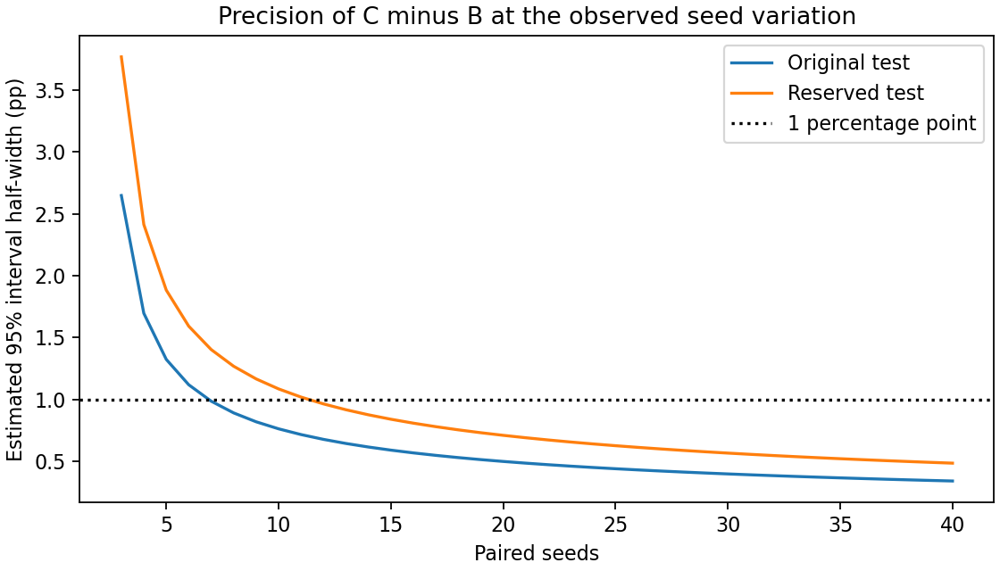
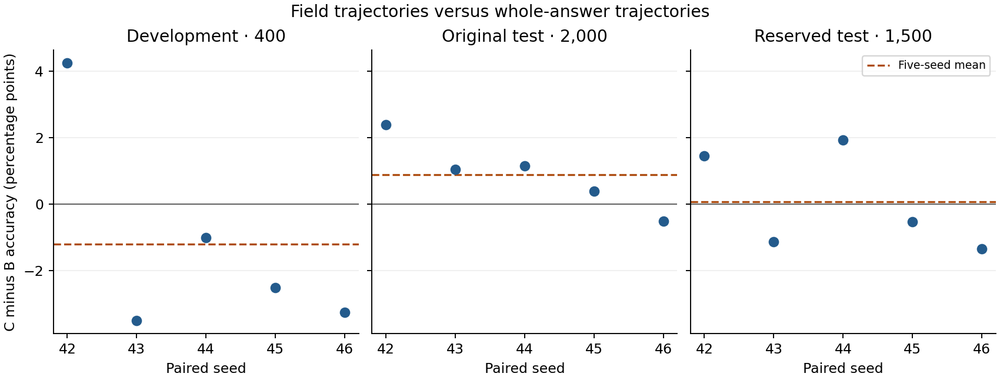
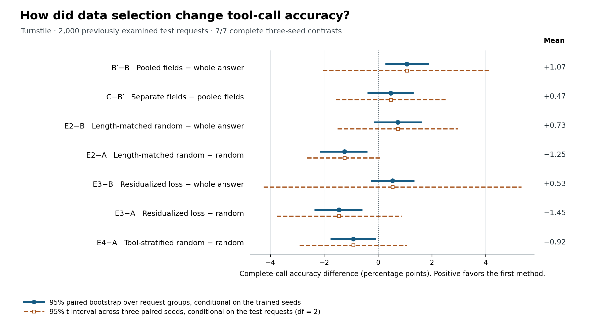
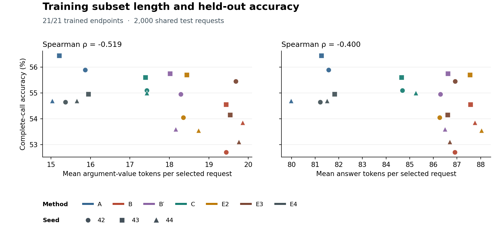

# Does tracking tool names and argument values separately improve training-data selection?

## Third round: seed sensitivity and budget controls

We fixed 15 independent method-by-seed subsets of 400 examples each before training. Each 10% run stops on first crossing 1,202,092 input tokens. Four new full-pool runs also save the first crossing of 3,005,228 tokens. The archived seed-42 full-pool model first crossed the smaller threshold at step 50 (1,203,490 tokens), and that adapter was retained. The two primary comparisons use paired seeds and Holm correction. The 1,500 evaluation requests were already examined in Round 2, including the seed-42 full-pool comparison. [Registration and split hashes](../results/followup/round3-registration.json)

**Completed CPU analysis.** Of the ten triples obtainable from the five observed seeds, four had positive C minus B differences at all three seeds on the original test. None did on the reserved test. These are frequencies within five specific runs. The paired-difference SD was 1.07 points on the original test and 1.52 points on the reserved test. At the latter SD, a planning calculation estimates 16 paired seeds for 80% power to detect a 1-point gain, or six for a 2-point gain (one-sided alpha 0.05). The variance estimate itself comes from only five pairs. This design calculation is separate from the two-sided Holm-adjusted tests for the new fits. [All method SDs, triples and power estimates](../results/followup/round3-seed-noise.json)

## Final evaluation on 1,500 reserved requests

Across five seeds on 1,500 reserved Turnstile single-call requests, complete-call accuracy averaged 55.19% for uniform random sampling (A), 54.57% for whole-answer trajectories (B), and 54.65% for field trajectories (C). C minus B averaged +0.08 percentage points (preregistered one-sided paired p = 0.456). The primary test did not reach the registered 0.05 threshold. The descriptive difference between C and uniform random sampling was -0.53 points.

For a 1,000-example fine-tune under this budget, uniform random sampling is the practical default. C produced six more correct predictions than B across 7,500 paired generations and 40 fewer than random. Its additional proxy training and scoring took about 41 minutes on an A40. The seed interval remains wide enough to include gains and losses of practical interest.

**Design and score.** Each configuration answered the same requests. A correct generation matched the reference call count, function and complete argument object under the frozen scorer. The untuned model scored 709/1,500 (47.27%). The 47 configurations produced 70,500 predictions across 1,500 distinct request groups. The November 25 amendment advanced the original December 5 opening after the original-test and BFCL results were known and before observing any reserved outcomes. The public commitment fixed the models, requests, scoring and primary comparison.

**Variation across seeds and requests.** The paired C minus B differences at seeds 42 through 46 were +1.47, -1.13, +1.93, -0.53, -1.33 points. The first three averaged +0.76 and the last two -0.93. Conditional on these requests, the two-sided 95% paired-seed t interval was [-1.80, +1.96] points (t = 0.12, df = 4). Holding the trained endpoints fixed and resampling request groups 10,000 times gave a 95% interval of [-0.79, +0.93]. The five-seed C minus B difference was +0.90 points on the previously examined test and −1.20 points on development.

| Seed | A correct | B correct | C correct | C only vs B | B only vs C |
|---:|---:|---:|---:|---:|---:|
| 42 | 815 | 806 | 828 | 97 | 75 |
| 43 | 849 | 834 | 817 | 72 | 89 |
| 44 | 818 | 801 | 830 | 107 | 78 |
| 45 | 829 | 822 | 814 | 77 | 85 |
| 46 | 828 | 830 | 810 | 76 | 96 |

**Sampling controls.** Long minus short sampling yielded -0.15 points. Random selection matched to B on length (E2) differed from A by +0.17 points. Difficulty-matched random selection (E2b) differed from A by -0.32. These comparisons estimate the performance of the sampling policies. A gradient-level explanation would require a separate intervention. Against the prespecified practical tolerance of ±1 point, the descriptive 90% interval for E2b minus A was [-1.40, +0.76] across seeds and [-1.09, +0.47] across request groups with models held fixed.

| Method | Seeds | Correct / predictions | Accuracy |
|---|---:|---:|---:|
| base | 1 | 709 / 1,500 | 47.27% |
| A | 5 | 4,139 / 7,500 | 55.19% |
| B | 5 | 4,093 / 7,500 | 54.57% |
| C | 5 | 4,099 / 7,500 | 54.65% |
| E2 | 5 | 4,152 / 7,500 | 55.36% |
| E2b | 5 | 4,115 / 7,500 | 54.87% |
| L-short | 5 | 4,122 / 7,500 | 54.96% |
| L-long | 5 | 4,111 / 7,500 | 54.81% |
| Bprime | 3 | 2,453 / 4,500 | 54.51% |
| E3 | 3 | 2,459 / 4,500 | 54.64% |
| E4 | 3 | 2,478 / 4,500 | 55.07% |
| full-s42-step125 | 1 | 847 / 1,500 | 56.47% |
| full-s42-step500 | 1 | 894 / 1,500 | 59.60% |

| Contrast | Paired seeds | Mean difference | Seed 95% CI | Request-group 95% CI, fixed seeds |
|---|---:|---:|---:|---:|
| B-A | 5 | -0.61 | [-1.23, +0.01] | [-1.57, +0.35] |
| Bprime-B | 3 | +0.27 | [-1.18, +1.71] | [-0.69, +1.24] |
| C-A | 5 | -0.53 | [-2.17, +1.10] | [-1.51, +0.43] |
| C-B | 5 | +0.08 | [-1.80, +1.96] | [-0.79, +0.93] |
| C-Bprime | 3 | +0.49 | [-2.17, +3.15] | [-0.53, +1.49] |
| E2-A | 5 | +0.17 | [-0.84, +1.18] | [-0.67, +1.00] |
| E2b-A | 5 | -0.32 | [-1.72, +1.08] | [-1.24, +0.61] |
| E2b-E2 | 5 | -0.49 | [-1.38, +0.40] | [-1.36, +0.36] |
| E3-A | 3 | -0.51 | [-3.66, +2.64] | [-1.56, +0.58] |
| E4-A | 3 | -0.09 | [-3.75, +3.57] | [-1.11, +0.96] |
| L-long-L-short | 5 | -0.15 | [-1.00, +0.70] | [-1.16, +0.85] |
| L-short-A | 5 | -0.23 | [-0.94, +0.49] | [-1.09, +0.64] |
| full-s42-step125-A | 1 | +2.13 | — | [+0.47, +3.87] |
| full-s42-step500-A | 1 | +5.27 | — | [+3.47, +7.07] |
| length_slope | 5 | -0.01 | [-0.08, +0.06] | [-0.09, +0.07] |

Differences are in percentage points. The length_slope row reports percentage points per additional token of mean training argument length. Single-seed comparisons have no seed interval. Inference is limited to this single-call corpus, model family and training budget. Round 2 registered 20 additional fits. Per-example loss, length-controlled field selection (C-LC), a 10% selection budget and a medium-difficulty arm remain open research questions.

**Verification and runtime.** Successful generation processes across all 47 configurations took 7.00 L4 hours in total. Billed time can also include setup and idle time. A separate local replay verified the committed artifacts, regraded every raw prediction and reproduced all aggregate statistics. [Machine-readable results](../results/followup/round2-holdout.json) · [Opening amendment](round2-opening-amendment.md)

## Five-seed follow-up

Each entry is mean complete-call accuracy over seeds 42–46 on the same 400 development and 2,000 previously examined test requests.

| Sampling policy | Development | Original test |
|---|---:|---:|
| A · Uniform random | 56.10% | 54.95% |
| B · Whole-answer trajectories | 54.45% | 53.75% |
| C · Separate name and value trajectories | 53.25% | 54.65% |
| E2 · Random, matched to B on argument length | 55.65% | 54.90% |
| E2b · Random, matched to B on difficulty | 54.90% | 55.38% |
| L-short · Short-argument sampling | 54.65% | 55.36% |
| L-long · Long-argument sampling | 55.25% | 54.53% |

On the original test, C exceeded B by 0.90 percentage points on average. The first three seeds averaged +1.53 points. The two additional seeds gave +0.40 and −0.50, averaging −0.05. C also trailed uniform random sampling by 0.30 points on this test and trailed B by 1.20 points on development. The additional seeds weaken the initial evidence for a field-selection advantage.

Matching B’s argument-length distribution alone produced an E2 minus A difference of −0.05 points on the original test. Long minus short sampling yielded −0.83 points on that test and +0.60 on development. These results leave the explanation for B’s deficit unresolved. The independent evaluation uses the frozen panel under the [published early-opening amendment](round2-opening-amendment.md). [Paired results by seed](../results/followup/round2-legacy.json) · [Frozen panel commitment](../results/followup/round2-holdout-freeze.json)

## Paired differences and measured compute

Each column compares two trained configurations on the same 2,000 original test requests at a matched seed. Differences are percentage points. The descriptive two-sided 95% t interval uses the five seed differences (4 degrees of freedom) and holds the requests fixed.

| Contrast | 42 | 43 | 44 | 45 | 46 | Mean | 95% CI |
|---|---:|---:|---:|---:|---:|---:|---:|
| C − B | +2.40 | +1.05 | +1.15 | +0.40 | -0.50 | +0.90 | [-0.42, +2.22] |
| C − A | -0.80 | -0.85 | +0.30 | +0.05 | -0.20 | -0.30 | [-0.93, +0.33] |
| B − A | -3.20 | -1.90 | -0.85 | -0.35 | +0.30 | -1.20 | [-2.91, +0.51] |
| E2 − A | -1.85 | -0.75 | -1.15 | +0.55 | +2.95 | -0.05 | [-2.40, +2.30] |
| E2b − A | +0.40 | -1.45 | +0.10 | +0.65 | +2.45 | +0.43 | [-1.30, +2.16] |
| L-long − L-short | -1.45 | -1.35 | +0.60 | -0.40 | -1.55 | -0.83 | [-1.98, +0.32] |

Across the 20 additional fits on one A40, successful training processes took 5.49 hours, development inference 1.34 hours and original-test inference 5.06 hours (11.89 hours total). These durations include process startup. Pilot runs, failed attempts, BFCL and the independent holdout are outside this total.

## External evaluation on BFCL Live

All 36 configurations answered the same 556 requests. The official BFCL AST checker scored each output. Accuracy is averaged across five seeds for each sampling method. The untuned base was evaluated once.

| Method | Single candidate (256 requests) | Multiple candidates (300 requests) |
|---|---:|---:|
| base | 71.09% | 69.67% |
| A | 73.91% | 72.00% |
| B | 71.33% | 71.67% |
| C | 72.89% | 72.00% |
| E2 | 73.83% | 72.13% |
| E2b | 73.67% | 71.93% |
| L-short | 74.14% | 71.87% |
| L-long | 72.97% | 72.67% |

C exceeded B by 1.56 percentage points on single-candidate requests and 0.33 points on multiple-candidate requests. Compared with random selection, C was 1.02 points lower on single-candidate requests and tied at 72.00% on multiple-candidate requests. These are descriptive comparisons on these requests and seeds. [Official score counts and five-seed contrasts](../results/followup/round2-bfcl-live.json) · [Panel composition](../results/followup/round2-bfcl-live-panel.json)

## Initial three-seed results

**On 2,000 held-out Turnstile requests requiring a single tool call, field-based selection outperformed whole-answer selection by an average of 1.53 percentage points. The difference was positive for all three seeds. Uniform random sampling had the highest mean accuracy.** With the same target-model training-token budget, complete-call accuracy averaged 55.68% for random sampling (A), 53.70% for whole-answer trajectories (B), and 55.23% for separate field trajectories (C). The paired 95% interval for C minus B was **+0.60 to +2.48** percentage points. C minus A averaged **−0.45** points, with an interval of **−1.42 to +0.53**. On both external BFCL single-turn subsets, C scored below B on average.

## Experimental comparison

Each Amazon Turnstile example supplies a user request, a system date, and descriptions of candidate tools. The model must generate one call. The internal scorer awards credit when it can parse the output, the call count and function name are correct, and all arguments match the reference call under the scoring rules. One missing argument or incorrect value makes the entire answer incorrect. This measures the ability to reproduce the reference call. Measuring task completion after executing the tool would require a separate evaluation.

We grouped exact and near-duplicate requests before splitting the data into 4,000 training candidates, 200 pilot requests, 400 development requests, and 2,000 held-out test requests. We fine-tuned a Qwen3.5-0.8B proxy with LoRA for one pass over the candidate pool. At steps 0, 10, 30, 80, and 250, we scored each token of the reference answer given its correct prefix. All three selection seeds reused the same proxy run and the same five scoring passes.

| Method | How it selects 1,000 of the 4,000 training candidates |
|---|---|
| A, uniform random sampling | Sample uniformly from the pool without replacement. |
| B, whole-answer trajectory | Average loss across all reference-answer tokens at each checkpoint, yielding a five-dimensional vector per candidate. |
| C, separate field trajectories | In the same forward pass, average function-name loss and argument-value loss separately. Two values per checkpoint yield a ten-dimensional vector. |

For B and C, we standardized each dimension, formed 10 clusters using the same K-means procedure, and sampled as evenly as possible across clusters. The selection method determines which examples the target model sees. All target models started from the same Qwen3.5-2B weights and used LoRA to train on the **complete reference call** with the same optimizer settings. The training budget was 3,005,228 non-padding input tokens, counting both prompts and answers. Each run stopped after the first update that reached the budget, allowing for the last update to overshoot. We used greedy decoding with vLLM. Before evaluating the held-out set, we locked the endpoints and verified the adapter hashes. [Design, budget, and scoring protocol](research-plan.md) · [Training and scoring code](../scripts/) · [Numerical checks on field losses](field-loss-validation.md)

## Held-out Turnstile results

At every seed, the three models answered the same 2,000 requests. The table gives counts and percentages of fully correct calls. Without project-specific fine-tuning, the 2B base model answered **944/2,000 (47.20%)** correctly.

| Seed | A, random | B, whole answer | C, separate fields | Only C correct / only B correct | C − B, percentage points (95% interval) |
|---:|---:|---:|---:|---:|---:|
| 42 | 1,118 (55.90%) | 1,054 (52.70%) | 1,102 (55.10%) | 132 / 84 | +2.40 (+0.95 to +3.80) |
| 43 | 1,129 (56.45%) | 1,091 (54.55%) | 1,112 (55.60%) | 123 / 102 | +1.05 (−0.45 to +2.50) |
| 44 | 1,094 (54.70%) | 1,077 (53.85%) | 1,100 (55.00%) | 120 / 97 | +1.15 (−0.30 to +2.55) |

At seed 42, C answered 48 more requests correctly than B, meeting the prespecified replication threshold of at least 2 percentage points with the lower interval bound above zero. The net gains at seeds 43 and 44 were 21 and 23 requests, respectively. Both individual intervals included zero. The primary comparison held the target training-token budget fixed. The C minus B contrast jointly changes the token positions scored, the weighting of the fields, and the dimensionality of the trajectory.

| Matched comparison across three fixed seeds | Mean difference (percentage points) | Paired 95% interval | Sample SD of differences across seeds |
|---|---:|---:|---:|
| C − B (primary) | +1.53 | +0.60 to +2.48 | 0.75 |
| C − A | −0.45 | −1.42 to +0.53 | 0.65 |
| B − A | −1.98 | −2.97 to −1.03 | 1.18 |
| A − base 2B | +8.48 | +7.02 to +9.93 | 0.89 |
| B − base 2B | +6.50 | +5.03 to +8.02 | 0.93 |
| C − base 2B | +8.03 | +6.45 to +9.63 | 0.32 |

Fine-tuning improved on the base model under all three selection strategies. The random baseline shows how much of the gain was attainable without scoring the pool with a proxy. Under these conditions, field information improved upon whole-answer selection. The comparison with uniform random sampling provides no evidence of an advantage for C.

**Interpreting the intervals.** Each of 2,000 bootstrap draws resampled the same held-out request groups jointly across all methods and seeds. We recalculated paired accuracy differences and took their 2.5th and 97.5th percentiles. The 2,000 requests belonged to 2,000 distinct near-duplicate groups. All three runs used the same test items, so the intervals describe how the mean difference for these trained seeds varies with the mix of test requests. Assessing sensitivity to new training seeds, proxies, candidate pools, or tool domains requires independent replication. [Primary statistical analysis](../scripts/summarize_course.py)

## What do field selection and separate trajectories each contribute?

At seed 42, we trained one additional arm, B′, to help interpret the difference between B and C. B′ uses the same function-name and argument-value token positions as C. At each checkpoint it averages all those tokens together, producing one five-dimensional trajectory. Comparing B′ with B tests what changes when scoring is restricted to these fields. Comparing C with B′ holds the token positions fixed. C takes separate means for the two fields, standardizes each dimension, and clusters the resulting ten-dimensional trajectories.

B, B′, and C answered 1,054, 1,099, and 1,102 of the 2,000 held-out requests correctly. We used the same request-level pairing as in the primary comparison.

| Seed 42 comparison | Only left correct | Only right correct | Net gain in correct requests | Accuracy difference (percentage points) | Paired 95% interval (percentage points) |
|---|---:|---:|---:|---:|---:|
| B′ − B (whole answer to pooled fields) | 132 | 87 | +45 | +2.25 | +0.80 to +3.65 |
| C − B′ (pooled to separate fields) | 101 | 98 | +3 | +0.15 | −1.30 to +1.55 |

The original experiment included B′ only at seed 42. At this seed the pooled-field arm gained 45 correct calls over B, while separating the fields gained another three. The individual gains varied when the two missing B′ models were trained in the follow-up.

### Three-seed controls for fields, length and tool coverage

The follow-up was registered after the original 2,000-request test had been examined. It added 11 training runs at the original target-token budget: B′ at seeds 43 and 44, and three seeds each for length-matched random sampling (E2), residualized whole-answer trajectories (E3) and tool-stratified random sampling (E4). Together with the ten original fits, this gives seven methods with three paired seeds each. Every score below uses the same test requests. The separate prospective holdout was kept sealed. [Follow-up registration](../results/followup/phase1-registration.json)

| Method | Seed 42 correct | Seed 43 correct | Seed 44 correct | Mean accuracy | Mean minus A (pp) | Mean minus B (pp) |
|---|---:|---:|---:|---:|---:|---:|
| A | 1,118 | 1,129 | 1,094 | 55.68% | 0.00 | +1.98 |
| B | 1,054 | 1,091 | 1,077 | 53.70% | −1.98 | 0.00 |
| B′ | 1,099 | 1,115 | 1,072 | 54.77% | −0.92 | +1.07 |
| C | 1,102 | 1,112 | 1,100 | 55.23% | −0.45 | +1.53 |
| E2 | 1,081 | 1,114 | 1,071 | 54.43% | −1.25 | +0.73 |
| E3 | 1,109 | 1,083 | 1,062 | 54.23% | −1.45 | +0.53 |
| E4 | 1,093 | 1,099 | 1,094 | 54.77% | −0.92 | +1.07 |

Each count is out of 2,000. The last two columns describe observed differences between three-seed means. The seven comparisons registered for paired interval estimation follow. [All counts, paired disagreements and intervals](../results/followup/phase1-results.json)

| Accuracy difference (pp) | Seed 42 | Seed 43 | Seed 44 | Mean | 95% request-group interval, fixed trained seeds | 95% seed t interval, fixed requests |
|---|---:|---:|---:|---:|---:|---:|
| B′ − B | +2.25 | +1.20 | −0.25 | +1.07 | [+0.27, +1.88] | [−2.05, +4.19] |
| C − B′ | +0.15 | −0.15 | +1.40 | +0.47 | [−0.40, +1.32] | [−1.58, +2.51] |
| E2 − B | +1.35 | +1.15 | −0.30 | +0.73 | [−0.15, +1.62] | [−1.50, +2.97] |
| E2 − A | −1.85 | −0.75 | −1.15 | −1.25 | [−2.15, −0.40] | [−2.63, +0.13] |
| E3 − B | +2.75 | −0.40 | −0.75 | +0.53 | [−0.27, +1.35] | [−4.26, +5.32] |
| E3 − A | −0.45 | −2.30 | −1.60 | −1.45 | [−2.37, −0.58] | [−3.77, +0.87] |
| E4 − A | −1.25 | −1.50 | 0.00 | −0.92 | [−1.77, −0.08] | [−2.91, +1.08] |

Averaged over these trained runs, restricting scores to the field tokens gained 1.07 pp over B. The sign reversed at seed 44, where separating the fields contributed the largest gain. The extra benefit of separate trajectories averaged 0.47 pp, with both intervals spanning zero. The seed t intervals have two degrees of freedom and describe sensitivity to the three observed seed pairs. The request-group intervals are pointwise across these post hoc comparisons.

E2 matched the number of requests B selected in each argument-value length bin and then sampled uniformly without replacement within that bin. E2 fell below unrestricted random selection (A) at every seed. Adopting B's length-bin quotas therefore had an observed cost for this random-within-bin sampling policy. E2 still led B by 0.73 pp on average. The registered equivalence rule required an unrounded paired 90% request-group interval strictly inside **(−1, +1) pp**. E2−B gave **[−0.02, +1.50]** and E2−A gave **[−1.98, −0.55]** after rounding. Neither met that rule. The results leave open how much of B's deficit to A is attributable to the quotas. E2 matched binned lengths while changing individual requests, difficulty and tool mix; its mean value length was 18.51 tokens versus 19.58 for B. [Selection and matching](../scripts/select_followup.py) · [Paired intervals and equivalence rule](../scripts/summarize_followup.py)

**Does removing predictable length-related variation from B's features help?** For E3 we fit a separate ordinary least-squares regression on all 4,000 training candidates at each of the five proxy checkpoints. The outcome was the whole-answer mean loss. The predictors were an intercept, log(1 + number of value tokens), the share of supervised answer tokens belonging to names or values, and log(total supervised answer tokens). We then standardized the five residuals, clustered them and applied B's sampling quotas. The 2B target still trained on complete calls.

E3 gained +2.75 pp over B at seed 42 but lost ground at seeds 43 and 44. Its mean gain of **+0.53 pp** fell short of the registered +1 pp threshold. E3 scored below A at every seed. The E3−A 90% paired group interval was **[−2.22, −0.70] pp**, outside the prespecified equivalence margin on the lower side. The fixed-test, three-seed 95% t interval was much wider, **[−3.77, +0.87] pp**. Neither criterion for the proposed residualization strategy was met. This result concerns removal of the fitted linear associations from the proxy features. Nonlinear relationships and changes in the selected examples' difficulty or tool mix remain possible. [Residualization and sampling](../scripts/select_followup.py)

**Does allocating seats by tool frequency help?** E4 assigned the 1,000 training slots in proportion to each reference function’s frequency, rounded fractional quotas by largest remainder with seeded tie-breaking, and sampled uniformly within each function. It covered 779, 776 and 781 distinct training functions across the three seeds, compared with 603, 605 and 595 for A. Of the 2,000 test requests, the reference function had appeared in E4’s selected training set for 1,655, 1,655 and 1,665 requests, compared with 1,293, 1,286 and 1,299 for A. Its mean accuracy difference from A was **−0.92 pp** (95% request-group interval [−1.77, −0.08], three-seed t interval [−2.91, +1.08]). This fell below the registered +1 pp threshold. At seeds 42 and 43 the broader coverage came with fewer correct calls, and at seed 44 the two methods tied. Stratification changed both the identities of the training requests and their distribution across tools. [Tool-quota implementation](../scripts/select_followup.py)

None of the three registered diagnostic patterns met all its criteria. On these fitted seeds A scored highest among the seven methods at the matched token budget. All seven 95% seed t intervals span zero. The evidence for differences across these specific test requests is stronger than the evidence for how the methods rank when retrained.

### Does the mix of easy and difficult values help explain the gap?

Here, a “difficult” argument is one to which the unadapted 0.8B proxy assigned low probability. We measured difficulty before proxy training by averaging the negative log-probability of the reference argument-value tokens of each request, conditioned on their correct prefixes. E2b drew 1,000 requests uniformly within length-by-difficulty cells. Its length-bin counts matched those of random A at the same seed, and its difficulty-bin counts matched those of trajectory-selected B. All three subsets met both margins exactly on a 10 × 10 grid. E2, the earlier control, matched B’s length bins and left difficulty unconstrained. [Registered comparisons](../results/followup/e2b-registration.json) · [Selection and balance](improvement-plan.md#how-to-construct-the-three-e2b-subsets)

E2b answered **1,126, 1,100 and 1,096 out of 2,000** correctly at seeds 42, 43 and 44, for a mean accuracy of **55.37%**. Each 2B run had the same training-token budget and used the same test requests. Differences below are in percentage points. The first 95% interval resamples request groups jointly for all three trained seeds. The second varies the three paired seed differences on the fixed test (t, two degrees of freedom). [Per-seed paired counts and intervals](../results/followup/e2b-results.json)

| Comparison | Seed 42 | Seed 43 | Seed 44 | Mean | 95% request-group interval, fixed seeds | 95% seed t interval, fixed requests |
|---|---:|---:|---:|---:|---:|---:|
| E2b − A | +0.40 | −1.45 | +0.10 | −0.32 | [−1.20, +0.58] | [−2.78, +2.15] |
| E2 − A | −1.85 | −0.75 | −1.15 | −1.25 | [−2.15, −0.40] | [−2.63, +0.13] |
| E2b − B | +3.60 | +0.45 | +0.95 | +1.67 | [+0.77, +2.55] | [−2.54, +5.87] |
| E2b − E2 | +2.25 | −0.70 | +1.25 | +0.93 | [0.00, +1.87] | [−2.79, +4.66] |

**The difficulty-only prediction did not recur consistently.** If B’s mix of hard-to-predict values explained its full 1.98 pp average deficit to A, one would expect a comparable average deficit when imposing that mix at A-like lengths. E2b finished 8 calls ahead of A at seed 42, 29 behind at seed 43 and 2 ahead at seed 44. Its average was 0.32 pp below A, with both intervals spanning zero. Equivalence was not tested. E2 fell below A at every seed, and E2b exceeded B at every seed, although the latter comparison’s three-seed interval spanned zero. These outcomes are compatible with a cost of the B-like length mix or other features of the particular requests B selects. E2b exceeded E2 by 0.93 pp on average, but the request-group interval touched zero and the direction changed at seed 43.

E2b−A asks what happens with B-like difficulty at A-like lengths. E2−A reuses the Phase 1 result for adopting B’s length quotas. E2b−B compares different length distributions and selection rules at matched difficulty-bin counts. E2b−E2 changes both the length and difficulty distributions. Even where one marginal distribution matches, exact values within bins, the joint distribution and the training examples can differ. E2b covered 557, 574 and 558 functions versus A’s 603, 605 and 595. These comparisons were registered after the original test had been opened. A factorial design using the same sampler across all four combinations and a newly sealed assessment would be needed to test separate length and difficulty effects prospectively.

## What happens when the target can train on the whole pool?

At seed 42 we trained one additional 2B model directly from the 4,000-candidate pool. The first checkpoint reached the same input-token budget as A/B/C, about half a pass over the larger pool. The subset models had spent approximately two passes on their respective sets of 1,000. The later full-pool checkpoint completed two passes. It also had the highest development score (259/400), so the final and best-development readouts share the same predictions.

| Full-pool checkpoint | Input tokens | Correct on the same 2,000 requests | Full minus A, pp [95% interval] | Full minus B | Full minus C |
|---|---:|---:|---:|---:|---:|
| Step 125, matched budget | 3,006,397 | 1,126 (56.30%) | +0.40 [−0.95, +1.65] | +3.60 [+2.00, +5.10] | +1.20 [−0.10, +2.60] |
| Step 500, two passes | 12,020,912 | 1,189 (59.45%) | +3.55 [+2.10, +5.05] | +6.75 [+5.15, +8.50] | +4.35 [+2.90, +5.90] |

The matched-budget run clearly exceeded B on this test. Its intervals against A and C included zero. Continuing the same full-pool run from step 125 to 500 yielded **63 net additional correct calls, +3.15 pp [+1.75, +4.60]**. On 139 requests only the later checkpoint was correct; on 76 only the earlier checkpoint was correct. The later run used four times the input tokens and encountered more of the pool, with further repetitions. The comparison cannot isolate the contribution of any one of these changes. All intervals resample the same held-out request groups and are conditional on seed 42.

On one A40, reaching the matched full-pool checkpoint used **0.269 h of target training** and **0.438 h including scheduled development evaluation**. Comparable standalone costs for A, B and C were 0.447, 1.120 and 1.122 h respectively, including 0.676 h for proxy training and scoring in each trajectory strategy. The full two-pass run took 61.59 minutes of target training and 38.27 minutes of development evaluation (1.664 h total). The table compares matched target tokens at step 125 and a larger training budget at step 500. These costs exclude final-test inference and idle time. [Machine-readable counts, paired contrasts and costs](../results/full-pool-reference.json) · [Full-pool summary implementation](../scripts/summarize_full_reference.py)

## How sensitive was the development result to the two random seeds?

The first two primary rounds changed the subset and target-training seeds together. Their development rankings reversed. We reused their saved B/C subsets and trained four additional targets, swapping the target-training seeds. Every cell below uses the same **400 development requests** and the same target training-token budget. The cells with matching seeds reuse their original checkpoints.

| Selection seed | Target-training seed | B correct | C correct | Only C / only B correct | C−B, pp [paired 95% interval] |
|---:|---:|---:|---:|---:|---:|
| 42 | 42 | 208 | 225 | 32 / 15 | +4.25 [+1.00, +7.26] |
| 42 | 43 | 222 | 209 | 24 / 37 | −3.25 [−7.00, +0.50] |
| 43 | 42 | 222 | 222 | 26 / 26 | 0.00 [−3.50, +3.50] |
| 43 | 43 | 221 | 207 | 19 / 33 | −3.50 [−7.00, 0.00] |

With the seed-42 subsets fixed, changing the training seed moved C−B from +4.25 to −3.25, a **−7.50 pp change [−12.00, −3.25]**. With the seed-43 subsets fixed, the corresponding change was **−3.50 pp [−8.25, +1.25]**. Averaged over the two settings of the other factor, changing the training seed from 42 to 43 moved C−B by −5.50 pp [−8.50, −2.625], and changing the selection seed moved it by −2.25 pp [−5.88, +1.38]. The interaction was +4.00 pp [−3.00, +11.25].

The rank reversal can thus occur with the training examples held fixed. These are exploratory comparisons on one development split, with two values for each seed. The 2,000 paired bootstrap draws resampled the same request groups together across all eight models. The intervals apply separately to each contrast. The design cannot estimate what fraction of training variance each source explains or establish a held-out generalization effect. [Machine-readable cell counts and all eight contrasts](../results/crossed-seeds.json) · [Paired analysis](../scripts/summarize_crossed_seeds.py)

## External tool-calling evaluation

We fixed two subsets of BFCL v4 Non-Live in advance. Each `simple_python` request provides one candidate tool. Each `multiple` request provides several candidates and requires a single call to one of them. Each subset contained 100 requests. We scored them using a pinned version of the official abstract syntax tree (AST) checker. The prespecified checks found zero matches to the training pool on either request text or named tool signatures. Semantic overlap and the base model's pretraining exposure remain uncertain.

| Seed | Single candidate, A / B / C (correct out of 100) | Multiple candidates, A / B / C (correct out of 100) |
|---:|---:|---:|
| 42 | 90 / 94 / 93 | 95 / 94 / 93 |
| 43 | 91 / 93 / 91 | 94 / 92 / 92 |
| 44 | 95 / 94 / 91 | 92 / 93 / 92 |
| Three-seed mean accuracy | 92.00% / 93.67% / 91.67% | 93.67% / 93.00% / 92.33% |

The base 2B model answered 78 single-candidate and 85 multiple-candidate requests correctly. At seed 42, B′ scored 93 and 92, respectively, and C scored 93 in both categories. Every fine-tuned arm improved on the base model in both subsets. The table gives mean differences and exploratory 95% intervals, in percentage points, conditional on the three fixed seeds.

| Comparison | Single candidate | Multiple candidates | Equal-weight mean across categories |
|---|---:|---:|---:|
| C − B | −2.00 (−4.33 to 0.00) | −0.67 (−3.00 to +1.67) | −1.33 (−3.00 to +0.33) |
| C − A | −0.33 (−2.33 to +1.67) | −1.33 (−3.67 to +0.67) | −0.83 (−2.33 to +0.67) |

We resampled the 100 distinct requests within each category with replacement 10,000 times, retaining all methods and seeds together for each request. The internal C minus B advantage did not replicate on these external subsets. All external intervals included zero. The equal-weight mean summarizes only these 200 requests. Turnstile and BFCL use different questions and scoring rules. [BFCL selection and official scoring](../scripts/bfcl_subset.py) · [Three-seed paired analysis](../scripts/summarize_bfcl_seeds.py)

## From proxy loss to downstream errors

At step 0, 53.35% of the 0.8B proxy's training candidates had a mean function-name loss below 0.01. This fraction had risen to 84.85% by step 10. By step 250, 96.35% were below the threshold for function names but only 29.70% for argument values. The two fields therefore became predictable at different rates when conditioned on the correct prefix.

B and C each selected 1,000 requests per seed. Their selections overlapped on only 421–428 requests. Candidates with low initial function-name loss and argument-value loss in the highest quartile accounted for 12.35% of the full pool, 21.0%–22.7% of B's selections, and 19.8%–20.6% of C's. Both methods oversampled this group, and B selected more such requests at every seed. Thus, selecting a greater number of these requests cannot explain C's advantage over B. [Training-pool statistics and definitions](experiment-log.md)

**Most of the gain occurred on requests for which both models had already selected the correct tool.** For each seed, we identified requests where B and C both produced the right tool and call count, then checked all the arguments. The two models' predictions jointly define the subset. It provides a descriptive breakdown of where their answers differed.

| Seed | Both correct on tool and call count | All arguments correct in this subset, B → C | Net gain in subset | Net gain on remaining requests | Net gain on full test |
|---:|---:|---:|---:|---:|---:|
| 42 | 1,964 | 1,052 → 1,094 | +42 | +6 | +48 |
| 43 | 1,963 | 1,087 → 1,106 | +19 | +2 | +21 |
| 44 | 1,953 | 1,071 → 1,094 | +23 | 0 | +23 |

Across all 2,000 requests, the number with **incorrect argument values** fell from 827 to 784, from 794 to 772, and from 791 to 778 for the three seeds, respectively. Requests with **missing argument keys** increased from 47 to 65, from 56 to 69, and from 35 to 61. A request can have more than one argument error. Comparing values copied directly from the request with those requiring format conversion or inference would require independent, blinded annotation. [Field-level diagnostics](../scripts/field_diagnostics.py)

## Compute cost and scope

Training the 0.8B proxy and scoring the complete pool five times took **40.56 minutes** on one NVIDIA A40. Several seeds and trajectory comparisons can share those scores. Either B or C, when run on its own, incurs this upfront cost. Target models trained for approximately two passes over their selected examples. Each training run took about 16 minutes, with additional time for generation and scoring.

On the 400-request development set, C minus B averaged −0.08 percentage points across the three seeds, with a paired interval of −2.08 to +2.00. The mean difference was positive on the larger held-out set, and the intervals overlapped. All test endpoints were locked according to token budget before the held-out predictions were inspected. The first development checkpoint with accuracy at least 3 points above the base model took 9.8–19.7 minutes for A and 50.7–51.8 minutes for B or C. These times include evaluation of all checkpoints up to that observation. They measure when we first **observed** the threshold being reached. The budget decision made before testing excluded the extension that would have spent the saved GPU time on further random-baseline training. The experiment therefore directly compares methods at equal target training-token budgets. [Measured costs and verification records](experiment-log.md)

The results support further study of field signals on similar synthetic single-call tasks, with uniform random sampling and independent tool sets retained as controls. Generalization to other model families, multi-step tool execution, or real users' task success remains open.

## Why did whole-answer selection trail random sampling?

This follow-up uses the opened Turnstile test and the original ten fine-tuned models. B selected longer argument values in every seed. In seed 42 it selected **all 144 examples from five small clusters** with mean value lengths of 24.8 to 335 tokens. It drew **172 of 1,659** examples from its largest cluster, whose mean was 13.7 tokens. Across ten runs, the rank correlation between mean training-set argument length and test accuracy was **−0.72**. The ten points share a proxy, repeat methods and use the same questions. A matched intervention is needed to attribute the accuracy gap to training-set length. [Cluster profiles](../results/followup/p03-cluster-profiles.csv) · [Run-level data](../results/followup/p01-length-accuracy.csv)

Across all 21 fitted models, the Spearman rank correlation between mean training-subset argument-value length and test accuracy weakened from **−0.72** in the original ten fits to **−0.52**. Using mean full-answer length gave **−0.71** in the original ten and **−0.40** in the complete set. Each point represents one method and seed. The runs share candidate and test requests, repeatedly use the same methods and seeds, and reuse a single proxy where required. These descriptive associations cannot estimate the effect of lengthening a training example or separate length from difficulty and tool composition. [Aggregate data for all 21 fits](../results/followup/phase1-length-accuracy.csv)

### Where did B lose correct calls against random sampling?

We rescored the original 18,000 generations from A, B, and C (2,000 requests × three arms × three seeds). The scorer assigns each failed call to its first failed check, in the order shown below. An argument failure can involve a missing or extra key, a type mismatch, or an incorrect value. The arrows show counts for A followed by B. The last two columns compare both models on the same requests.

| Seed | Parse, A → B | Call count, A → B | Function, A → B | Arguments, A → B | Only A correct / only B correct | Net extra errors for B |
|---:|---:|---:|---:|---:|---:|---:|
| 42 | 3 → 5 | 0 → 0 | 16 → 22 | 863 → 919 | 169 / 105 | +64 |
| 43 | 2 → 7 | 0 → 0 | 24 → 20 | 845 → 882 | 139 / 101 | +38 |
| 44 | 5 → 2 | 1 → 0 | 22 → 35 | 878 → 886 | 128 / 111 | +17 |

B made 119 net extra errors over the three evaluations of the same 2,000 requests. The first-failure totals changed by +101 for arguments, +15 for functions, +4 for parsing and −1 for call count. Argument failures accounted for 84.9% of the net gap. At seed 44, wrong functions contributed 13 net extra errors and arguments contributed eight. [Verified counts and paired disagreements](../results/followup/review-reconciliation.json)

### Did longer training examples help on longer test requests?

We counted tokens in the argument values of each **reference** call and divided the test set at its quartiles. Exactly 137, 71, and 34 requests fell on the cutpoints of 8, 12, and 21 tokens, respectively. Keeping ties in the lower bin gives the denominators below. Each contrast uses the same requests and three fixed seeds. Its pointwise 95% interval resamples request groups within that bin.

| Reference value tokens | Requests | A accuracy | B accuracy | C accuracy | B−A, pp (95%) | C−A, pp (95%) |
|---|---:|---:|---:|---:|---:|---:|
| 1–8 | 622 | 71.86% | 68.44% | 71.38% | −3.43 (−5.41 to −1.61) | −0.48 (−2.47 to +1.39) |
| 9–12 | 424 | 60.85% | 58.88% | 59.83% | −1.97 (−4.09 to +0.08) | −1.02 (−3.46 to +1.34) |
| 13–21 | 473 | 50.88% | 49.75% | 50.74% | −1.13 (−2.96 to +0.70) | −0.14 (−2.11 to +1.83) |
| 22–214 | 481 | 34.93% | 33.96% | 34.72% | −0.97 (−2.43 to +0.62) | −0.21 (−1.87 to +1.46) |

The shortest bin contained 31.1% of the requests and contributed −1.07 points to B's overall −1.98-point deficit, about 54%. Weighting the four C−A estimates by their request counts recovers −0.45 points. We then directly compared the B−A gap on the shortest versus longest requests. It was more negative in the shortest bin at every seed (−3.92, −2.93 and −0.53 pp), averaging **−2.46 pp**. The 95% interval from resampling the 1,103 distinct request groups jointly across seeds was **−4.92 to +0.03**. Holding the requests fixed, the three-seed t interval was **−6.79 to +1.87**. We chose this contrast after inspecting the four bins. The short-bin contribution is observable in this test, while the size of the short-versus-long difference remains uncertain. [Slice analysis](../s2l_tool_calling/analysis/followup_length_slices.py) · [Per-checkpoint counts and B−A and C−B intervals](../results/followup/p04-length-slices.json)

In the longest bin, the three method means were roughly 34–35%. The ten fine-tuned checkpoints ranged from 33.06% to 36.38%, including 35.14% for B′ at seed 42. The original base model scored 27.65% (133/481). Only 13 of these 481 questions had at least 64 value tokens, and only two reached 128. The broad-bin average gives little information about the extreme tail. The B−A interval allows for a small gain or a loss even across the full bin.

In the training pool, 927 candidates exceeded 21 value tokens. B selected 304, 315, and 327 of them at seeds 42, 43, and 44. On the test set, the analysis groups questions by **reference** length. Estimating the marginal return from allocating training slots to long examples requires changing **training** length composition under controlled selection. [Training counts, longest-bin outcomes and contrasts](../results/followup/review-reconciliation.json)

For tools seen only in A's selected training set, A had 29 net additional correct calls over C across three passes on the same test. For tools seen only in C's set, C had 26 net additional correct calls over A. These are exploratory comparisons. [Coverage and discordant calls](../results/followup/p02-ac-disagreement.csv)

How far does C’s 1.53-point advantage over B generalize? With the three trained pairs held fixed, the 95% request-group interval is +0.60 to +2.48. Holding the 2,000 test requests fixed and using the three observed seed differences instead gives a 95% t interval of −0.34 to +3.40 (two degrees of freedom). The second estimate is sensitive to the small number of seeds. The follow-up controls repeated the pooled-field comparison and changed the length or function composition of the selected data. We separately reserved 1,500 unused requests for a prospective method evaluation. [All seed-sensitivity contrasts](../results/followup/p05-intervals.csv) · [Follow-up design](improvement-plan.md)
