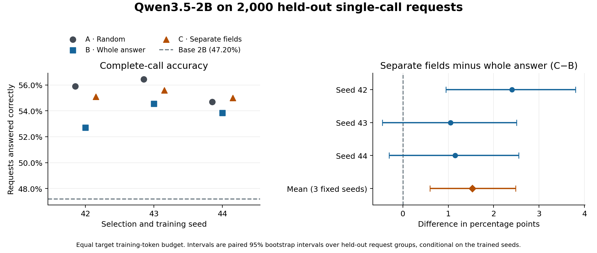
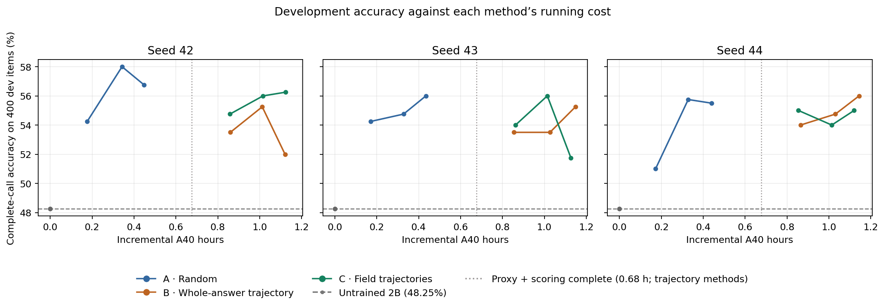
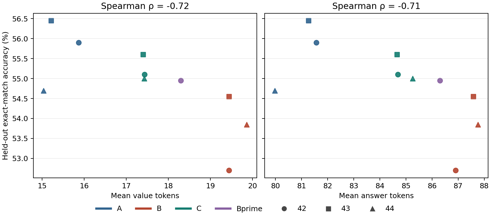

# Does tracking tool names and argument values separately improve training-data selection?

**On 2,000 held-out Turnstile requests requiring a single tool call, field-based selection outperformed whole-answer selection by an average of 1.53 percentage points. The difference was positive for all three seeds. Uniform random sampling had the highest mean accuracy.** With the same target-model training-token budget, complete-call accuracy averaged 55.68% for random sampling (A), 53.70% for whole-answer trajectories (B), and 55.23% for separate field trajectories (C). The paired 95% interval for C minus B was **+0.60 to +2.48** percentage points. C minus A averaged **−0.45** points, with an interval of **−1.42 to +0.53**. On both external BFCL single-turn subsets, C scored below B on average.

## Experimental comparison

Each Amazon Turnstile example supplies a user request, a system date, and descriptions of candidate tools. The model must generate one call. The internal scorer awards credit when it can parse the output, the call count and function name are correct, and all arguments match the reference call under the scoring rules. One missing argument or incorrect value makes the entire answer incorrect. This measures the ability to reproduce the reference call. Measuring task completion after executing the tool would require a separate evaluation.

We grouped exact and near-duplicate requests before splitting the data into 4,000 training candidates, 200 pilot requests, 400 development requests, and 2,000 held-out test requests. We fine-tuned a Qwen3.5-0.8B proxy with LoRA for one pass over the candidate pool. At steps 0, 10, 30, 80, and 250, we scored each token of the reference answer given its correct prefix. All three selection seeds reused the same proxy run and the same five scoring passes.

| Method | How it selects 1,000 of the 4,000 training candidates |
|---|---|
| A, uniform random sampling | Sample uniformly from the pool without replacement. |
| B, whole-answer trajectory | Average loss across all reference-answer tokens at each checkpoint, yielding a five-dimensional vector per candidate. |
| C, separate field trajectories | In the same forward pass, average function-name loss and argument-value loss separately. Two values per checkpoint yield a ten-dimensional vector. |

For B and C, we standardized each dimension, formed 10 clusters using the same K-means procedure, and sampled as evenly as possible across clusters. The selection method determines which examples the target model sees. All target models started from the same Qwen3.5-2B weights and used LoRA to train on the **complete reference call** with the same optimizer settings. The training budget was 3,005,228 non-padding input tokens, counting both prompts and answers. Each run stopped after the first update that reached the budget, allowing for the last update to overshoot. We used greedy decoding with vLLM. Before evaluating the held-out set, we locked the endpoints and verified the adapter hashes. [Design, budget, and scoring protocol](research-plan.md) · [Training and scoring code](../scripts/) · [Numerical checks on field losses](field-loss-validation.md)

## Held-out Turnstile results

At every seed, the three models answered the same 2,000 requests. The table gives counts and percentages of fully correct calls. Without project-specific fine-tuning, the 2B base model answered **944/2,000 (47.20%)** correctly.

| Seed | A, random | B, whole answer | C, separate fields | Only C correct / only B correct | C − B, percentage points (95% interval) |
|---:|---:|---:|---:|---:|---:|
| 42 | 1,118 (55.90%) | 1,054 (52.70%) | 1,102 (55.10%) | 132 / 84 | +2.40 (+0.95 to +3.80) |
| 43 | 1,129 (56.45%) | 1,091 (54.55%) | 1,112 (55.60%) | 123 / 102 | +1.05 (−0.45 to +2.50) |
| 44 | 1,094 (54.70%) | 1,077 (53.85%) | 1,100 (55.00%) | 120 / 97 | +1.15 (−0.30 to +2.55) |

At seed 42, C answered 48 more requests correctly than B, meeting the prespecified replication threshold of at least 2 percentage points with the lower interval bound above zero. The net gains at seeds 43 and 44 were 21 and 23 requests, respectively. Both individual intervals included zero. The primary comparison held the target training-token budget fixed. The C minus B contrast jointly changes the token positions scored, the weighting of the fields, and the dimensionality of the trajectory.

| Matched comparison across three fixed seeds | Mean difference (percentage points) | Paired 95% interval | Sample SD of differences across seeds |
|---|---:|---:|---:|
| C − B (primary) | +1.53 | +0.60 to +2.48 | 0.75 |
| C − A | −0.45 | −1.42 to +0.53 | 0.65 |
| B − A | −1.98 | −2.97 to −1.03 | 1.18 |
| A − base 2B | +8.48 | +7.02 to +9.93 | 0.89 |
| B − base 2B | +6.50 | +5.03 to +8.02 | 0.93 |
| C − base 2B | +8.03 | +6.45 to +9.63 | 0.32 |

Fine-tuning improved on the base model under all three selection strategies. The random baseline shows how much of the gain was attainable without scoring the pool with a proxy. Under these conditions, field information improved upon whole-answer selection. The comparison with uniform random sampling provides no evidence of an advantage for C.

**Interpreting the intervals.** Each of 2,000 bootstrap draws resampled the same held-out request groups jointly across all methods and seeds. We recalculated paired accuracy differences and took their 2.5th and 97.5th percentiles. The 2,000 requests belonged to 2,000 distinct near-duplicate groups. All three runs used the same test items, so the intervals describe how the mean difference for these trained seeds varies with the mix of test requests. Assessing sensitivity to new training seeds, proxies, candidate pools, or tool domains requires independent replication. [Primary statistical analysis](../scripts/summarize_course.py)

## What do field selection and separate trajectories each contribute?

At seed 42, we trained one additional arm, B′, to help interpret the difference between B and C. B′ uses the same function-name and argument-value token positions as C. At each checkpoint it averages all those tokens together, producing one five-dimensional trajectory. Comparing B′ with B tests what changes when scoring is restricted to these fields. Comparing C with B′ holds the token positions fixed. C takes separate means for the two fields, standardizes each dimension, and clusters the resulting ten-dimensional trajectories.

B, B′, and C answered 1,054, 1,099, and 1,102 of the 2,000 held-out requests correctly. We used the same request-level pairing as in the primary comparison.

| Seed 42 comparison | Only left correct | Only right correct | Net gain in correct requests | Accuracy difference (percentage points) | Paired 95% interval (percentage points) |
|---|---:|---:|---:|---:|---:|
| B′ − B (whole answer to pooled fields) | 132 | 87 | +45 | +2.25 | +0.80 to +3.65 |
| C − B′ (pooled to separate fields) | 101 | 98 | +3 | +0.15 | −1.30 to +1.55 |

Of the 48 additional correct answers for C over B at this seed, pooled-field selection already gained 45 over B. Separating the fields changed 101 answers from wrong to correct and 98 from correct to wrong, a net gain of only 3. Restricting the score to field tokens may therefore account for most of the observed improvement in this run. All three seeds contributed to C versus B, but only seed 42 included B′. The ablation leaves the additional value of separating the trajectories uncertain and does not establish equivalence between B′ and C.

## What happens when the target can train on the whole pool?

At seed 42 we trained one additional 2B model directly from the 4,000-candidate pool. The first checkpoint reached the same input-token budget as A/B/C, about half a pass over the larger pool. The subset models had spent approximately two passes on their respective sets of 1,000. The later full-pool checkpoint completed two passes. It also had the highest development score (259/400), so the final and best-development readouts share the same predictions.

| Full-pool checkpoint | Input tokens | Correct on the same 2,000 requests | Full minus A, pp [95% interval] | Full minus B | Full minus C |
|---|---:|---:|---:|---:|---:|
| Step 125, matched budget | 3,006,397 | 1,126 (56.30%) | +0.40 [−0.95, +1.65] | +3.60 [+2.00, +5.10] | +1.20 [−0.10, +2.60] |
| Step 500, two passes | 12,020,912 | 1,189 (59.45%) | +3.55 [+2.10, +5.05] | +6.75 [+5.15, +8.50] | +4.35 [+2.90, +5.90] |

The matched-budget run clearly exceeded B on this test. Its intervals against A and C included zero. Continuing the same full-pool run from step 125 to 500 yielded **63 net additional correct calls, +3.15 pp [+1.75, +4.60]**. On 139 requests only the later checkpoint was correct; on 76 only the earlier checkpoint was correct. The later run used four times the input tokens and encountered more of the pool, with further repetitions. The comparison cannot isolate the contribution of any one of these changes. All intervals resample the same held-out request groups and are conditional on seed 42.

On one A40, reaching the matched full-pool checkpoint used **0.269 h of target training** and **0.438 h including scheduled development evaluation**. Comparable standalone costs for A, B and C were 0.447, 1.120 and 1.122 h respectively, including 0.676 h for proxy training and scoring in each trajectory strategy. The full two-pass run took 61.59 minutes of target training and 38.27 minutes of development evaluation (1.664 h total). The table compares matched target tokens at step 125 and a larger training budget at step 500. These costs exclude final-test inference and idle time. [Machine-readable counts, paired contrasts and costs](../results/full-pool-reference.json) · [Full-pool summary implementation](../scripts/summarize_full_reference.py)

## External tool-calling evaluation

We fixed two subsets of BFCL v4 Non-Live in advance. Each `simple_python` request provides one candidate tool. Each `multiple` request provides several candidates and requires a single call to one of them. Each subset contained 100 requests. We scored them using a pinned version of the official abstract syntax tree (AST) checker. The prespecified checks found zero matches to the training pool on either request text or named tool signatures. Semantic overlap and the base model's pretraining exposure remain uncertain.

| Seed | Single candidate, A / B / C (correct out of 100) | Multiple candidates, A / B / C (correct out of 100) |
|---:|---:|---:|
| 42 | 90 / 94 / 93 | 95 / 94 / 93 |
| 43 | 91 / 93 / 91 | 94 / 92 / 92 |
| 44 | 95 / 94 / 91 | 92 / 93 / 92 |
| Three-seed mean accuracy | 92.00% / 93.67% / 91.67% | 93.67% / 93.00% / 92.33% |

The base 2B model answered 78 single-candidate and 85 multiple-candidate requests correctly. At seed 42, B′ scored 93 and 92, respectively, and C scored 93 in both categories. Every fine-tuned arm improved on the base model in both subsets. The table gives mean differences and exploratory 95% intervals, in percentage points, conditional on the three fixed seeds.

| Comparison | Single candidate | Multiple candidates | Equal-weight mean across categories |
|---|---:|---:|---:|
| C − B | −2.00 (−4.33 to 0.00) | −0.67 (−3.00 to +1.67) | −1.33 (−3.00 to +0.33) |
| C − A | −0.33 (−2.33 to +1.67) | −1.33 (−3.67 to +0.67) | −0.83 (−2.33 to +0.67) |

We resampled the 100 distinct requests within each category with replacement 10,000 times, retaining all methods and seeds together for each request. The internal C minus B advantage did not replicate on these external subsets. All external intervals included zero. The equal-weight mean summarizes only these 200 requests. Turnstile and BFCL use different questions and scoring rules. [BFCL selection and official scoring](../scripts/bfcl_subset.py) · [Three-seed paired analysis](../scripts/summarize_bfcl_seeds.py)

## From proxy loss to downstream errors

At step 0, 53.35% of the 0.8B proxy's training candidates had a mean function-name loss below 0.01. This fraction had risen to 84.85% by step 10. By step 250, 96.35% were below the threshold for function names but only 29.70% for argument values. The two fields therefore became predictable at different rates when conditioned on the correct prefix.

B and C each selected 1,000 requests per seed. Their selections overlapped on only 421–428 requests. Candidates with low initial function-name loss and argument-value loss in the highest quartile accounted for 12.35% of the full pool, 21.0%–22.7% of B's selections, and 19.8%–20.6% of C's. Both methods oversampled this group, and B selected more such requests at every seed. Thus, selecting a greater number of these requests cannot explain C's advantage over B. [Training-pool statistics and definitions](experiment-log.md)

**Most of the gain occurred on requests for which both models had already selected the correct tool.** For each seed, we identified requests where B and C both produced the right tool and call count, then checked all the arguments. The two models' predictions jointly define the subset. It provides a descriptive breakdown of where their answers differed.

| Seed | Both correct on tool and call count | All arguments correct in this subset, B → C | Net gain in subset | Net gain on remaining requests | Net gain on full test |
|---:|---:|---:|---:|---:|---:|
| 42 | 1,964 | 1,052 → 1,094 | +42 | +6 | +48 |
| 43 | 1,963 | 1,087 → 1,106 | +19 | +2 | +21 |
| 44 | 1,953 | 1,071 → 1,094 | +23 | 0 | +23 |

Across all 2,000 requests, the number with **incorrect argument values** fell from 827 to 784, from 794 to 772, and from 791 to 778 for the three seeds, respectively. Requests with **missing argument keys** increased from 47 to 65, from 56 to 69, and from 35 to 61. A request can have more than one argument error. Comparing values copied directly from the request with those requiring format conversion or inference would require independent, blinded annotation. [Field-level diagnostics](../scripts/field_diagnostics.py)

## Compute cost and scope

Training the 0.8B proxy and scoring the complete pool five times took **40.56 minutes** on one NVIDIA A40. Several seeds and trajectory comparisons can share those scores. Either B or C, when run on its own, incurs this upfront cost. Target models trained for approximately two passes over their selected examples. Each training run took about 16 minutes, with additional time for generation and scoring.

On the 400-request development set, C minus B averaged −0.08 percentage points across the three seeds, with a paired interval of −2.08 to +2.00. The mean difference was positive on the larger held-out set, and the intervals overlapped. All test endpoints were locked according to token budget before the held-out predictions were inspected. The first development checkpoint with accuracy at least 3 points above the base model took 9.8–19.7 minutes for A and 50.7–51.8 minutes for B or C. These times include evaluation of all checkpoints up to that observation. They measure when we first **observed** the threshold being reached. The budget decision made before testing excluded the extension that would have spent the saved GPU time on further random-baseline training. The experiment therefore directly compares methods at equal target training-token budgets. [Measured costs and verification records](experiment-log.md)

The results support further study of field signals on similar synthetic single-call tasks, with uniform random sampling and independent tool sets retained as controls. Generalization to other model families, multi-step tool execution, or real users' task success remains open.

## Why did whole-answer selection trail random sampling?

This follow-up uses the opened Turnstile test and the original ten fine-tuned models. B selected longer argument values in every seed. In seed 42 it selected **all 144 examples from five small clusters** with mean value lengths of 24.8 to 335 tokens. It drew **172 of 1,659** examples from its largest cluster, whose mean was 13.7 tokens. Across ten runs, the rank correlation between mean training-set argument length and test accuracy was **−0.72**. The ten points share a proxy, repeat methods and use the same questions. A matched intervention is needed to attribute the accuracy gap to training-set length. [Cluster profiles](../results/followup/p03-cluster-profiles.csv) · [Run-level data](../results/followup/p01-length-accuracy.csv)

### Where did B lose correct calls against random sampling?

We rescored the original 18,000 generations from A, B, and C (2,000 requests × three arms × three seeds). The scorer assigns each failed call to its first failed check, in the order shown below. An argument failure can involve a missing or extra key, a type mismatch, or an incorrect value. The arrows show counts for A followed by B. The last two columns compare both models on the same requests.

| Seed | Parse, A → B | Call count, A → B | Function, A → B | Arguments, A → B | Only A correct / only B correct | Net extra errors for B |
|---:|---:|---:|---:|---:|---:|---:|
| 42 | 3 → 5 | 0 → 0 | 16 → 22 | 863 → 919 | 169 / 105 | +64 |
| 43 | 2 → 7 | 0 → 0 | 24 → 20 | 845 → 882 | 139 / 101 | +38 |
| 44 | 5 → 2 | 1 → 0 | 22 → 35 | 878 → 886 | 128 / 111 | +17 |

B made 119 net extra errors over the three evaluations of the same 2,000 requests. The first-failure totals changed by +101 for arguments, +15 for functions, +4 for parsing and −1 for call count. Argument failures accounted for 84.9% of the net gap. At seed 44, wrong functions contributed 13 net extra errors and arguments contributed eight. [Verified counts and paired disagreements](../results/followup/review-reconciliation.json)

### Did longer training examples help on longer test requests?

We counted tokens in the argument values of each **reference** call and divided the test set at its quartiles. Exactly 137, 71, and 34 requests fell on the cutpoints of 8, 12, and 21 tokens, respectively. Keeping ties in the lower bin gives the denominators below. Each contrast uses the same requests and three fixed seeds. Its pointwise 95% interval resamples request groups within that bin.

| Reference value tokens | Requests | A accuracy | B accuracy | C accuracy | B−A, pp (95%) | C−A, pp (95%) |
|---|---:|---:|---:|---:|---:|---:|
| 1–8 | 622 | 71.86% | 68.44% | 71.38% | −3.43 (−5.41 to −1.61) | −0.48 (−2.47 to +1.39) |
| 9–12 | 424 | 60.85% | 58.88% | 59.83% | −1.97 (−4.09 to +0.08) | −1.02 (−3.46 to +1.34) |
| 13–21 | 473 | 50.88% | 49.75% | 50.74% | −1.13 (−2.96 to +0.70) | −0.14 (−2.11 to +1.83) |
| 22–214 | 481 | 34.93% | 33.96% | 34.72% | −0.97 (−2.43 to +0.62) | −0.21 (−1.87 to +1.46) |

The shortest bin contained 31.1% of the requests and contributed −1.07 points to B's overall −1.98-point deficit, about 54%. Weighting the four C−A estimates by their request counts recovers −0.45 points. We then directly compared the B−A gap on the shortest versus longest requests. It was more negative in the shortest bin at every seed (−3.92, −2.93 and −0.53 pp), averaging **−2.46 pp**. The 95% interval from resampling the 1,103 distinct request groups jointly across seeds was **−4.92 to +0.03**. Holding the requests fixed, the three-seed t interval was **−6.79 to +1.87**. We chose this contrast after inspecting the four bins. The short-bin contribution is observable in this test, while the size of the short-versus-long difference remains uncertain. [Slice analysis](../s2l_tool_calling/analysis/followup_length_slices.py) · [Per-checkpoint counts and B−A and C−B intervals](../results/followup/p04-length-slices.json)

In the longest bin, the three method means were roughly 34–35%. The ten fine-tuned checkpoints ranged from 33.06% to 36.38%, including 35.14% for B′ at seed 42. The original base model scored 27.65% (133/481). Only 13 of these 481 questions had at least 64 value tokens, and only two reached 128. The broad-bin average gives little information about the extreme tail. The B−A interval allows for a small gain or a loss even across the full bin.

In the training pool, 927 candidates exceeded 21 value tokens. B selected 304, 315, and 327 of them at seeds 42, 43, and 44. On the test set, the analysis groups questions by **reference** length. Estimating the marginal return from allocating training slots to long examples requires changing **training** length composition under controlled selection. [Training counts, longest-bin outcomes and contrasts](../results/followup/review-reconciliation.json)

For tools seen only in A's selected training set, A had 29 net additional correct calls over C across three passes on the same test. For tools seen only in C's set, C had 26 net additional correct calls over A. These are exploratory comparisons. [Coverage and discordant calls](../results/followup/p02-ac-disagreement.csv)

How far does C’s 1.53-point advantage over B generalize? With the three trained pairs held fixed, the 95% request-group interval is +0.60 to +2.48. Holding the 2,000 test requests fixed and using the three observed seed differences instead gives a 95% t interval of −0.34 to +3.40 (two degrees of freedom). The second estimate is sensitive to the small number of seeds. The new diagnostic controls repeat the pooled-field comparison and change the length or function composition of the selected data. We separately reserved 1,500 unused requests for a prospective method evaluation. [All seed-sensitivity contrasts](../results/followup/p05-intervals.csv) · [Follow-up design](improvement-plan.md)
